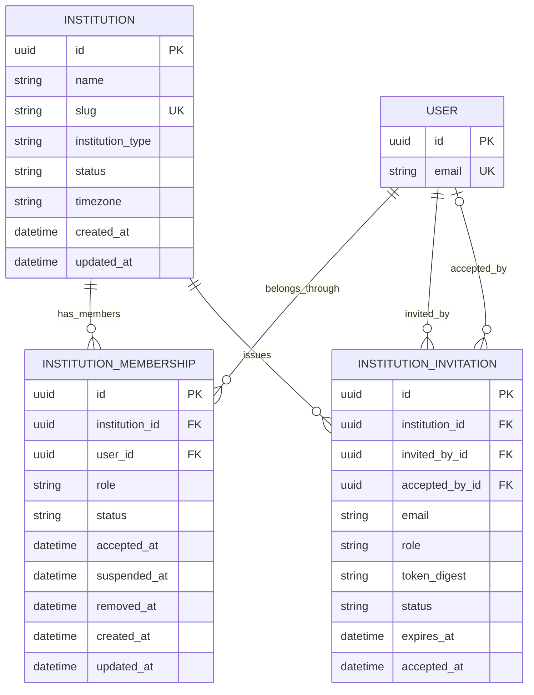
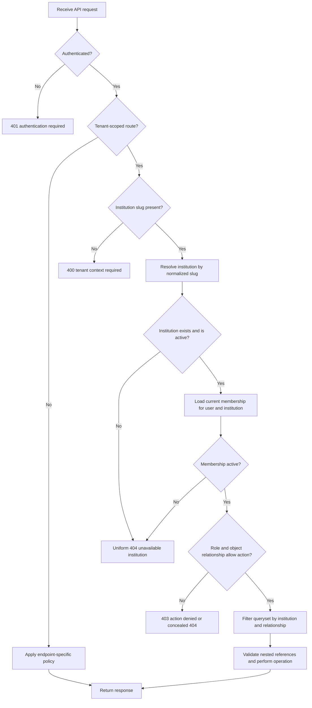

# Multi-Tenancy Architecture

**Status:** Proposed; review required before future tenant-owned domain features
**Scope:** Initial shared-schema tenancy for the Django modular monolith

The unresolved identity, lifecycle, authentication, authorization,
invitation, ownership, tenant-resolution, and platform-access choices below
remain provisional. The existing session, tenant-resolution, and generic
role-permission code is implementation baseline, not approval of the remaining
architecture proposals. Review the
[tenant and authentication decision register](./decisions/TENANT_AND_AUTH_DECISIONS.md)
for the alternatives, trade-offs, proposed defaults, and required project-owner
approvals. Neither this proposal nor a merged documentation PR constitutes
approval; do not treat its summary table as an implementation contract until
the relevant decisions are explicitly accepted.

## Context and objectives

The repository currently has a Django 6 / Django REST Framework foundation,
PostgreSQL configuration, a UUID/email user model, session authentication,
Institution and Membership models, tenant resolution, and a reusable
institution-role permission foundation. It does not implement business APIs or
object-level authorization. This document proposes broader boundaries; it does
not claim they are fully implemented or production-ready.

The initial design must support many schools, colleges, and universities in one
application and PostgreSQL database while ensuring that every tenant-scoped
operation is authorized on the backend. A user may participate in multiple
institutions, and institution identifiers are locators, never credentials.

### Objectives

- Start with a modular monolith, one PostgreSQL database, and a shared schema.
- Make tenant ownership explicit in the data model and API contracts.
- Enforce membership, role, and object-level access on every request.
- Keep lifecycle and operational behavior testable without adding tenancy
  dependencies or premature permission abstractions.
- Leave a path to stronger database isolation if risk or scale later justifies it.

### Out of scope

This proposal does not define or implement a final role/action policy matrix,
object-level authorization, invitations, Row-Level Security, business modules,
or deployment infrastructure. The repository has Institution and Membership
foundation models and implements path-based tenant resolution plus a generic
role permission boundary. Schema-per-tenant and database-per-tenant are
deliberately deferred.

## Architectural decisions

| Concern | Initial decision |
|---|---|
| Application shape | Django modular monolith with domain apps and explicit service/API boundaries |
| Tenant boundary | An `Institution` represents one tenant |
| Storage | Shared PostgreSQL database and shared schema; tenant-owned rows carry an institution foreign key |
| User identity | Keep one global account per person; connect it to institutions through membership |
| Tenant role | Store one initial role on each institution membership, not on the global user |
| Request context | Use an explicit institution slug in tenant-scoped API paths, then validate current membership |
| Enforcement | Resolve tenant and membership at the API boundary; scope querysets and nested lookups to that tenant |
| Lifecycle | Suspend or close records rather than deleting institutions, memberships, or audit history |

These are proposals pending review. The existing user and
Institution/Membership migrations are implementation baseline. Tenant
resolution and a reusable membership-role permission exist; a project-approved
role/action matrix and object-level tenant authorization do not.

## Proposed entities and lifecycle

### Institution

Proposed fields:

- `id`: UUID primary key.
- `name`: required institution display name.
- `slug`: required, normalized, globally unique URL identifier. Slug changes need
  an explicit redirect/compatibility policy; it is not an authorization secret.
  Ordinary model saves enforce slug immutability; `QuerySet.update()`,
  `bulk_update()`, and raw SQL bypass this model-level rule and are not protected
  by the portable database constraints.
- `institution_type`: constrained value such as `school`, `college`,
  `university`, or `other`.
- `status`: `onboarding`, `active`, `suspended`, or `closed`.
- `timezone`: optional IANA timezone, defaulting to UTC, for institution-local
  schedules and date boundaries.
- `created_at`, `updated_at`: timezone-aware timestamps.

Avoid adding address, billing, branding, or academic-calendar fields until
their owning features establish requirements. `suspended` blocks ordinary
tenant access; `closed` is a terminal/archived state, not a hard delete. A
platform support operation may restore a suspended institution under an
auditable, separately authorized workflow.

### User, membership, and invitation

`User` remains the global authentication identity. `InstitutionMembership`
joins a user to an institution and contains the tenant-scoped role, status
(`active`, `suspended`, or `removed`), and lifecycle timestamps such as
`accepted_at`, `suspended_at`, and `removed_at`. The separate invitation
represents the pending/invited state before membership is active. Keep a
membership row when access is removed so history and audit references remain
intact. A unique institution/user pair prevents duplicate memberships;
reinstatement is an explicit state transition.

Use a separate `InstitutionInvitation` because an invite may exist before the
recipient has an account. It should contain institution, normalized email,
assigned role, inviter, status, expiry, creation/acceptance timestamps, and a
cryptographically random token stored only as a digest. Acceptance requires an
authenticated account with a verified matching email and atomically consumes
the invitation while creating or reactivating the membership. An invitee cannot
choose or elevate their own role. Pending invites should be unique per
institution and normalized email, with expiry and revocation behavior defined.

Membership removal and invitation revocation are distinct. Invitation
acceptance, suspension, removal, role changes, and institution status changes
should be auditable with actor, target, time, and outcome. Enforce transaction-
safe rules so the last active owner cannot be removed, suspended, or demoted
until another owner exists.

The nullable user references on an invitation represent its inviter and, after
acceptance, its accepting account; the invitation email is the recipient before
an account exists. A future guardian-to-student relationship is a separate,
explicitly authorized domain relationship, not an implication of sharing an
institution.

## Roles and authorization

The implemented `Membership.Role` choices are `institution_admin`,
`academic_staff`, `finance_staff`, `student`, and `guardian`. The role/action
tables below remain proposals; they do not amend those model choices or approve
any role/action grant.

`InstitutionRolePermission` is a reusable default-deny DRF permission. A
protected view composes it after `IsAuthenticated` and
`InstitutionTenantPermission`, then declares a non-empty immutable
`allowed_membership_roles` tuple or frozenset on that view. Missing, empty, or
unknown declarations are denied. The permission requires the request-local
`TenantContext` produced by tenant resolution and re-queries the active
membership for that user and institution on every request before comparing its
stored role. Client-supplied role, institution, and membership values are not
authorization inputs. This is a function-level foundation only: it does not
establish a role/action matrix, role hierarchy, or object-level permissions.

The model currently stores one role on each `Membership`. These role summaries
are proposals only; operation-specific defaults and conditions are in the
[institution role/permission matrix](./INSTITUTION_ROLE_PERMISSION_MATRIX.md):

| Existing role | Proposed boundary; not an approved grant |
|---|---|
| `institution_admin` | Institution administration only as individually authorized; not an owner or unrestricted student/finance-data role |
| `academic_staff` | Academic workflows only within explicitly assigned scope |
| `finance_staff` | Finance workflows only within approved finance scope and segregation controls |
| `student` | Potential self-access only after a server-verified student relationship and per-domain rules |
| `guardian` | Potential linked-learner access only after a verified relationship, consent, and per-domain policy exist; otherwise deny |

No role implies a hierarchy, broad object access, or authority in another
institution. There is no modelled owner, teacher, or platform-support role.
Sensitive operations, including membership management, publication, finance
approval, and audit access, require explicit policies and object-level controls.

### Django Groups and Permissions

Use a combination, but do not use Django `Group` as the tenant role:

- The role on `Membership` represents the user's authority at one
  institution. `User.groups` and Django's model permissions are global to the
  user and cannot safely express different roles in two institutions.
- Centralized, small policy functions should answer role/action checks with the
  active membership and, when needed, the object or relationship. Keep those
  checks reusable from views, services, and jobs.
- Django model permissions may supplement global platform administration or
  coarse application capabilities. `is_staff` only grants access to the Django
  admin site; it is not tenant membership or tenant authority. Restrict
  superusers as break-glass operators and audit their use.
- Do not create a configurable role/permission editor yet. Revisit a custom
  permission model only when real requirements need per-institution custom
  roles or delegated permissions.

## Tenant resolution and request lifecycle

PR5 implemented the first tenant-resolution boundary in the Django/DRF API.
Institution slug context is read only from
`/api/v1/institutions/{institution_slug}/context/`; the existing Django session
authentication remains the authentication mechanism. The resolver queries the
current Institution and Membership for every request and exposes an immutable
request-local `TenantContext` to the context view.

At this boundary, `draft` and `active` institutions are eligible for ordinary
tenant context access, while `suspended` and `closed` institutions are
unavailable. Only active memberships grant access. Unknown or unavailable
institutions return 404, while non-member and suspended or removed memberships
return 403. This behavior implements tenant resolution. The separate role-permission
foundation is available for future protected views; the context endpoint itself
does not apply role/action restrictions. A project-approved role/action policy
and object-level authorization remain future work.

Use a canonical tenant-scoped URL such as
`/api/v1/institutions/{institution_slug}/students/`. The authenticated user's
membership list can populate a tenant picker, but a selected institution is
only a request locator. Every request must resolve the institution from the
server-side database and validate the user's current active membership and
the role required for the action.

The API boundary should make the validated institution and membership explicit
to downstream handlers. Do not rely on mutable process globals, thread-local
state, a frontend-selected tenant, or a token claim alone. A tenant identifier
inside a token can become stale when a membership is suspended or removed.

### Validation and tenant switching

- Requests without an explicit tenant context must not infer one from the
  user's only membership, session, or previous request. Tenant-scoped routes
  reject missing context.
- Unknown, inactive, or non-member institutions should have a consistent
  unavailable response (normally `404`) so a caller cannot enumerate tenants.
  Return `401` for missing authentication; return `403` for a known,
  tenant-scoped action the active member may not perform when revealing the
  resource is safe. Conceal unauthorized object existence with `404`.
- Validate slugs and UUIDs as input, but never treat validation or possession
  as proof of authorization. Do not accept conflicting tenant identifiers in
  a path, header, query string, or body.
- Tenant switching is a client navigation choice, not a privilege grant. The
  next request names the chosen institution; the server repeats institution
  lifecycle and membership checks. A future convenience endpoint may return a
  user's institutions, and a switch endpoint may validate a selection, but
  neither creates durable tenant authority.
- If a later API requires a tenant header, define one canonical source of
  context and reject requests where it conflicts with the path. Do not add a
  second, weaker resolution path for convenience.

## Tenant isolation and data access rules

Every tenant-owned model should have a non-null `institution` foreign key,
including child records where independently querying or exporting them is
possible. Put tenant authorization into the queryset and service boundary, not
only the frontend or serializer.

1. **List and retrieve:** begin with a queryset scoped to the validated
   institution (and role-specific relationship). Resolve detail objects from
   that queryset rather than a global manager lookup by primary key.
2. **Create:** derive `institution` from the validated request context and set
   it server-side. Ignore or reject client-supplied institution fields.
3. **Update and delete:** scope the target object before permission evaluation;
   never allow clients to move a row to another institution. Make tenant
   ownership read-only and disallow reparenting except for a separately
   designed, audited migration workflow.
4. **Nested relationships:** load every parent and referenced child through
   the active tenant's queryset. Validate that all related rows share the
   same institution before saving; do not trust a submitted foreign key.
   Prefer database constraints and unique keys that include institution where
   supported and appropriate.
5. **Authorization:** check both institution membership/role and object-level
   scope. A tenant-wide role does not bypass assignment, self-access, or
   guardian/student-link rules.
6. **Background work:** pass institution ID and initiating actor/system
   identity explicitly in job arguments. Reload the institution, check its
   status, and use tenant-scoped querysets in the task. Revalidate permission
   when work executes; never serialize a request object or rely on request-
   local context. Any intentionally cross-tenant maintenance job must use a
   separate, narrowly authorized service path and be auditable.
7. **Admin:** do not expose tenant records through unrestricted default admin
   querysets or forms. Restrict admin views, related-object selectors, actions,
   and bulk operations by institution and actor. Keep platform support access
   separate from institution roles and log sensitive access.
8. **Exports and reports:** scope source querysets before aggregations,
   pagination, file generation, caches, and download authorization. Bind
   generated files to institution and requester, use short-lived authorized
   downloads, and avoid shared cache keys that omit tenant identity.

Application-level filtering is the initial enforcement layer and must be
covered by tests. PostgreSQL Row-Level Security could provide defense in depth
later, but is not part of this design's first implementation: it requires
transaction-scoped tenant context, correct behavior with connection pooling,
and deliberate policies for migrations and privileged jobs. It cannot replace
application authorization.

## Security threats, mitigations, and verification

| Risk | Practical mitigation | Required verification |
|---|---|---|
| IDOR through guessed UUIDs/slugs | Resolve objects only from a tenant-scoped queryset after authentication and membership checks; identifiers are not secrets | A member of institution A cannot read, change, or delete institution B records by substituting UUIDs or slugs |
| Broken access control | Default-deny permission classes plus centralized role/action policy and object-level relationship checks | Exercise each role against allowed and denied endpoints, methods, services, and nested objects |
| Cross-tenant leakage | Required institution foreign keys, scoped querysets for all data paths, validated relations, tenant-aware cache/export keys | Test lists, pagination, search, aggregates, nested serializers, exports, attachments, and cached responses with two institutions |
| Privilege escalation | Derive tenant from validated context; reject client role/ownership fields; restrict role assignment; preserve an active owner | Test self-promotion, cross-institution role updates, forged owner fields, concurrent last-owner removal/demotion, and platform-role separation |
| Unverified tenant switching | Treat URL/header/session selection as a locator; recheck current institution and active membership on every request | Test switching to non-member, suspended/closed, removed membership, changed slug, conflicting context, and stale token/session state |
| Error-response data leakage | Use uniform unavailable responses for unknown/non-member tenants; return generic client errors without stack traces, SQL, or foreign object details | Assert error status/body equivalence across unknown and unauthorized tenant IDs and verify logs do not expose secrets or unrelated records |
| Background-job tenant context loss | Require explicit tenant and actor/system arguments; fail closed when absent; reload lifecycle and scope every task query | Test missing/mismatched tenant IDs, a queued task after membership/institution suspension, cross-tenant related IDs, and retries |

Tenant tests should use at least two institutions with distinct users and
records, including a user who belongs to both. Verify that switching between
the user's own institutions changes scope but never bypasses role checks.
Include unauthenticated, inactive account, removed/suspended membership,
inactive institution, and cross-tenant nested-reference cases. Run security-
critical query tests against PostgreSQL in CI as database-specific constraints
are introduced.

## Alternatives considered

- **Schema-per-tenant / database-per-tenant:** stronger physical separation and
  tenant-specific operations, but substantially more migration, connection,
  provisioning, backup, and operational complexity. Rejected for the initial
  stage; reconsider for contractual isolation or scale requirements.
- **Tenant in subdomain or host:** can improve routing and branding but adds
  DNS, proxy, cookie, host-validation, and local-development concerns. A URL
  path is the simpler initial API contract. Hostnames would still require
  membership authorization.
- **Client-selected `X-Institution-ID` as authority:** easy to send but easy to
  trust accidentally, and conflicts with alternate context sources. Rejected
  as the primary contract; any future header is only a locator and must be
  validated.
- **Django Groups as tenant roles:** groups and user permissions are global to
  a user, so they cannot represent different roles in different institutions.
  Rejected for tenant membership roles.
- **Custom configurable role/permission framework:** flexible but premature
  before role/action requirements exist. Deferred in favor of a small
  membership role and centralized checks.
- **PostgreSQL Row-Level Security from day one:** useful as defense in depth,
  but increases dependence on transaction boundaries, connection lifecycle,
  admin behavior, and test setup. Deferred until operational semantics can be
  implemented and verified end to end.

## Trade-offs, limitations, and future migration

Shared-schema tenancy is operationally simple and supports cross-tenant
platform operations, but a missed filter can expose records across
institutions. Django does not automatically infer tenant scope; safety depends
on consistent query/service patterns and exhaustive regression tests. UUIDs
reduce accidental enumeration but do not mitigate IDOR. One global user makes
multi-institution access straightforward, while requiring every policy and
membership lifecycle to be institution-specific.

Before creating migrations, confirm role semantics, invitation policy,
institution slug ownership/change rules, account/authentication strategy,
institution suspension behavior, audit retention, and administrator recovery.
Keep tenant ownership explicit on rows and avoid coupling domain models to a
particular tenant-schema library. If stronger isolation becomes necessary,
inventory tenant foreign keys and cross-tenant references, define data
backfill/validation, and plan staged rollout, rollback, restore, and export
behavior before moving data or adopting PostgreSQL RLS.

## Decisions requiring review

1. Approve shared-schema tenancy and the institution-scoped URL path as the
   initial API contract.
2. Confirm institution types/statuses and whether `timezone` is an appropriate
   initial institution field.
3. Confirm the proposed global user + separate invitation + institution
   membership lifecycle.
4. Review the five implemented membership roles and approve or amend the
   operation-by-operation role/action matrix, including whether guardian
   access to explicitly linked students will be supported.
5. Decide authentication/session strategy, invite email verification, and
   account recovery before implementing membership acceptance.
6. Agree on institution slug mutation/redirect policy, audit retention, and
   platform support/break-glass access.
7. Confirm PostgreSQL-backed CI and tenant-isolation regression tests are
   required before tenant-scoped business APIs.
