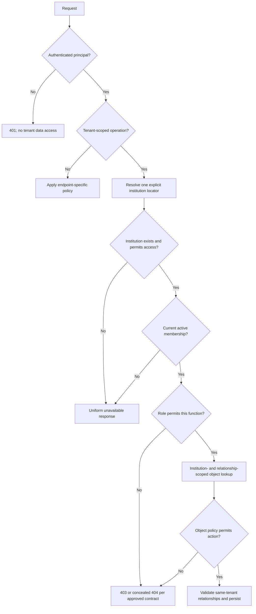

# Tenant Isolation Test Strategy

**Status:** Test architecture only; no tenant isolation behavior or tests are
implemented by this document.
**Scope:** Proposed shared-schema tenancy in the Django modular monolith.

## Purpose and current baseline

This strategy turns the boundaries proposed in
[`MULTI_TENANCY.md`](./MULTI_TENANCY.md) into a future, executable regression
plan. It does not approve unresolved architecture choices or claim that the
application is tenant-safe.

The current backend has a global UUID/email `User`, its initial migration,
session authentication endpoints, health/readiness endpoints, PostgreSQL test
settings, and implemented Institution and Membership foundation models. It has
no invitation models or business APIs. Tenant resolution now exists for the
`GET /api/v1/institutions/{institution_slug}/context/` boundary, but tenant
authorization remains partial: a reusable default-deny DRF permission now
checks explicitly declared membership roles against the current active
membership, but no production business view uses it yet. The context endpoint
does not make role/action decisions. Object-level isolation remains
unimplemented. Invitation models, admin tenant workflows, background task
systems, cache isolation, export pipelines, and tenant audit logs also remain
absent. Tenant-resolution API tests establish the institution and membership
eligibility boundary; isolated authorization API tests establish permission
behavior, while broader business-endpoint tenant-isolation regression tests in
this document remain planned.

The CI workflow runs the current backend suite with PostgreSQL 17 and
explicitly selects `config.settings.test_postgres`; ordinary local pytest
uses in-memory SQLite. See [CI guidance](../engineering/CI.md) and the
[backend workflow](../../.github/workflows/backend-ci.yml). CI being present
does not itself establish tenant isolation.

## Security boundary and authorization stages

Treat these responsibilities as separate decisions. Passing one stage is not
evidence that a later stage is safe.

| Stage                       | Question answered                                                                      | Required behavior                                                                                                                                                        |
| --------------------------- | -------------------------------------------------------------------------------------- | ------------------------------------------------------------------------------------------------------------------------------------------------------------------------ |
| Authentication              | Who is making this request?                                                            | Establish an authenticated, active principal using the eventual authentication contract; otherwise deny before tenant data access.                                       |
| Tenant resolution           | Which institution does this request name?                                              | Resolve one canonical, explicit institution locator from the request against the database. A slug or UUID is a locator, not a credential.                                |
| Membership validation       | May this principal act in that institution now?                                        | Load the current membership and institution lifecycle state for every request; do not treat a token claim, prior request, or invitation as active membership.            |
| Function/role authorization | May this principal perform this operation in this institution?                         | Apply a default-deny role/action policy to the current membership. Institution-wide role does not imply access to every action.                                          |
| Object-level authorization  | May this principal act on this particular object and its relationships?                | Scope lookups to the validated institution and also check assignment, self-access, guardian link, or other object-specific policy.                                       |
| Integrity enforcement       | Can an invalid cross-institution relationship be persisted despite application checks? | Use database constraints where they can express the invariant; retain application validation and authorization. Constraints do not authenticate callers or grant access. |

The response mapping in this diagram follows the current proposal, not an
approved API contract: missing tenant context should be rejected (proposed
`400`), unknown, inactive, or non-member institutions should normally be
indistinguishable (`404`), and a known forbidden action may return `403` only
when revealing the resource is safe. Confirm the contract before executable
tests lock in status codes or response bodies.

## Threat model

Assume an attacker can create or control an ordinary account, know or guess
public identifiers, submit arbitrary request data, replay stale links or
credentials they legitimately possess, call endpoints directly without using
the frontend, and observe response status, body, counts, timing at a coarse
scale, and externally visible side effects. Do not assume possession of one
institution's account grants access to another. Treat compromised platform
operators and database administrators as separate privileged threat classes;
the application test plan cannot prove the security of their credentials or
infrastructure.

| Threat                                                 | Attacker capability                                                                                          | Vulnerable design or failure mode                                                                                     | Security invariant                                                                                                                                             | Required regression test                                                                                                                                 | Primary mitigation layer(s)                                                  |
| ------------------------------------------------------ | ------------------------------------------------------------------------------------------------------------ | --------------------------------------------------------------------------------------------------------------------- | -------------------------------------------------------------------------------------------------------------------------------------------------------------- | -------------------------------------------------------------------------------------------------------------------------------------------------------- | ---------------------------------------------------------------------------- |
| IDOR / guessed identifiers                             | Substitute another institution's slug, UUID, or child ID.                                                    | Global manager lookup authorizes only by possession of an identifier.                                                 | Knowing an identifier never grants access; the object is resolved only within an authorized scope.                                                             | Retrieve, update, and delete Tenant B objects using a Tenant A context; compare with positive Tenant B access.                                           | Tenant resolver; scoped querysets; object authorization; response contract.  |
| Broken object-level authorization (BOLA)               | Use an otherwise allowed endpoint against an object outside permitted assignments or relationships.          | Institution membership or broad role is treated as sufficient for every object.                                       | Each object operation checks both institution scope and object-specific relationship policy.                                                                   | Exercise teacher/student/guardian or future equivalent against unassigned, non-self, or unlinked records in the same and another tenant.                 | Object permission/service policy; scoped lookup; API integration tests.      |
| Broken function-level authorization (BFLA)             | Invoke administrative, membership, export, or role-changing actions directly.                                | Endpoint checks authentication but omits an action-specific role check.                                               | Each action is default-deny and checked against the current institution-specific role.                                                                         | Run an allow/deny role-action matrix for every sensitive method and service.                                                                             | Function/role authorization; API and service tests.                          |
| Cross-tenant queryset leakage                          | Request list, detail, related, or default-manager query paths.                                               | A missing filter, global related manager, or unscoped detail lookup returns foreign rows.                             | Every tenant-owned read starts from the validated institution and applicable relationship scope.                                                               | Seed distinct records in A and B; enumerate list/detail/related paths as each tenant and assert only its records appear.                                 | Query/service boundary; object authorization; database integration tests.    |
| Cross-tenant writes and relationship injection         | Submit a foreign institution ID, owner field, or foreign-key ID.                                             | Client-supplied tenant fields are trusted, or serializer validation checks only existence.                            | Tenant ownership is derived server-side; every referenced row belongs to the validated institution; rejected writes have no foreign side effects.              | Submit B's institution and relationship IDs in A create/update requests; inspect all rows and relationships afterward.                                   | Serializer/service validation; transaction boundary; database constraints.   |
| Privilege escalation                                   | Change own role, assign a stronger role, forge staff/owner fields, or exploit global Django permissions.     | Role is user-global, client-controlled, or not checked on membership mutation.                                        | Only an authorized actor can grant an allowed role in that institution; tenant roles never imply platform authority.                                           | Attempt self-promotion, cross-tenant assignment, forged privilege fields, and unauthorized owner transfer.                                               | Role policy; serializer/service; database invariants; audit.                 |
| Membership suspension or revocation                    | Continue using a valid session/token after membership becomes inactive.                                      | Membership is trusted from cached claims or is not reloaded after status changes.                                     | Current membership status is checked at the authorization boundary; suspended/removed users lose tenant access promptly.                                       | Authenticate, suspend/remove the membership, replay the same credential, and assert denial with no side effects.                                         | Membership validation; cache/token invalidation policy; API integration.     |
| Unauthorized tenant switching                          | Select an institution the caller does not belong to or conflict path context with a header/body/query value. | A tenant selector is treated as proof or multiple sources resolve inconsistently.                                     | Every switch is a new locator selection followed by fresh lifecycle and membership validation; one canonical source is used.                                   | Switch from A to B as an A-only user; submit conflicting tenant locators; compare with permitted multi-member switch.                                    | Tenant resolution; membership validation; request parsing.                   |
| Institution suspension, closure, or lifecycle race     | Access a suspended/closed tenant or race a request against a status change.                                  | Lifecycle is checked only when a session begins or status changes are not enforced consistently.                      | Ordinary access follows the approved lifecycle policy on every operation; suspension cannot leave a hidden access path.                                        | Request reads and writes after suspension/closure; race lifecycle transition against a tenant request and assert policy-defined outcome.                 | Tenant resolver; membership/service policy; transaction semantics.           |
| Nested resource access                                 | Substitute a foreign parent or child ID in nested URLs or payloads.                                          | Parent is scoped but nested child is loaded globally, or vice versa.                                                  | Parent and child are both authorized and belong to the same validated institution.                                                                             | Cross tenant A's parent with B's child ID for retrieve, update, and create; assert denial and unchanged records.                                         | Nested queryset/service validation; database constraints.                    |
| Bulk operation abuse                                   | Include mixed-tenant IDs in bulk update, delete, import, or create.                                          | Bulk ORM methods bypass per-object checks or partially mutate unauthorized rows.                                      | Every item is authorized; a foreign item cannot be changed; atomic/partial semantics are explicit and cannot hide unauthorized changes.                        | Send a mixed A/B batch; assert B rows are unchanged and exact documented all-or-nothing/partial behavior for A. Prefer reject-whole-batch before writes. | Bulk service validation; transaction; database constraints; API tests.       |
| Search, filtering, pagination, and aggregation leakage | Probe filters, search terms, counts, ordering, facets, or aggregates.                                        | Tenant filter is applied after pagination/aggregation or omitted in a secondary query.                                | Every result set and derived count/aggregate is computed over the authorized scope only.                                                                       | Compare A results, total counts, page boundaries, empty searches, facets, and aggregate outputs with B-only fixture changes.                             | Query layer; API integration; PostgreSQL database integration.               |
| Reports, exports, and downloadable files               | Request another tenant's report, file key, export token, or generated artifact.                              | Source query is global, file ID is a bearer secret, or download route skips authorization.                            | Source rows and artifact authorization are tenant- and requester-scoped at generation and download time.                                                       | Generate A/B artifacts; try cross-tenant IDs/URLs, replay after revocation, and inspect contents and metadata.                                           | Export service; object authorization; storage access controls; audit.        |
| Background tasks and scheduled jobs                    | Trigger a task or exploit missing/stale job context.                                                         | Task uses global querysets, trusts serialized request context, or processes all tenants accidentally.                 | Each tenant-scoped job receives explicit tenant and actor/system identity, reloads lifecycle state, scopes every query, and fails closed if context is absent. | Run with missing/mismatched tenant IDs; revoke membership or suspend institution before execution; assert no out-of-scope writes.                        | Task/service boundary; database scope; idempotency and audit.                |
| Django admin and management commands                   | Use an admin relation selector/action or invoke an operational command.                                      | Admin querysets/actions are global; a command silently processes all institutions.                                    | Admin access is explicitly platform- or tenant-authorized; tenant-targeted commands require explicit scope; any cross-tenant command is narrow and auditable.  | When added, test list/detail/related selectors/actions and invoke command without, with unauthorized, and with explicit tenant scope.                    | Admin/command boundary; operator authorization; audit; tests.                |
| Cache keys and stale context                           | Prime or query cache under a different tenant, or reuse a request worker.                                    | Key omits institution/role/object scope or mutable global/thread-local context persists.                              | Cache identity includes every authorization-relevant dimension; request context is explicit and cannot bleed between requests.                                 | Prime A then request B (and reverse); test role/membership changes and concurrent requests with distinct contexts.                                       | Cache design; explicit dependency passing; concurrency tests.                |
| Audit log leakage or forgery                           | Read another tenant's events or cause a false actor/tenant attribution.                                      | Audit queries are global, event tenant/actor are client-supplied, or payloads expose sensitive data.                  | Audit attribution is server-derived, reads are scoped, and events do not expose another tenant's records or secrets.                                           | Attempt cross-tenant event reads and forged actor/tenant fields; assert correct attribution and safe event contents.                                     | Audit writer/reader service; authorization; logging policy.                  |
| Error and resource-existence disclosure                | Compare responses for unknown, inactive, non-member, or foreign object IDs.                                  | Different statuses/bodies or debug exceptions reveal foreign existence or database details.                           | Concealed resources use the approved uniform response; errors contain no foreign data, SQL, stack traces, or secrets.                                          | Compare normalized responses for unknown versus non-member IDs; assert no foreign identifiers/data in body and safe logs.                                | Error mapping; API boundary; logging; contract tests.                        |
| Concurrent request/context leakage                     | Send simultaneous requests for different tenants through shared workers/connections.                         | Mutable process globals, unsafe thread-local state, connection state, or shared client state carries tenant A into B. | Tenant context is request-scoped and explicit; concurrency cannot change the principal, institution, query scope, or response.                                 | Use independent clients/connections and synchronized requests; assert each response and side effect matches its own tenant.                              | Request/service design; transaction/connection management; PostgreSQL tests. |
| Failed transactions and partial writes                 | Cause a late validation/constraint failure after some writes.                                                | Multi-step writes are not atomic or rollback leaves cross-tenant relationships/data behind.                           | A rejected multi-step operation leaves no partial or cross-tenant mutation, according to the agreed transaction contract.                                      | Force failure after parent/child staging; reload all affected rows and verify rollback/invariants.                                                       | Service transaction boundary; database integration.                          |
| Database constraint bypass                             | Exploit concurrent writes or non-API code paths to create invalid tenant relationships.                      | Only serializers enforce same-tenant relationships, or expected composite invariants cannot be expressed by schema.   | Database constraints enforce representable ownership/uniqueness invariants in addition to application authorization.                                           | Attempt invalid relationships through ORM/raw persistence paths and concurrent inserts; assert database rejection.                                       | PostgreSQL schema constraints; migrations; database integration.             |

Application tests cannot prove protection from a compromised database
administrator, insecure backups, stolen infrastructure credentials, or
network-level access. Those require operational controls and separate reviews.
Timing measurements are noisy: use response-shape and observable side-effect
assertions for regression tests, and handle statistical side-channel assessment
as a separate performance/security exercise rather than a brittle unit test.

## Tenant isolation test matrix

Every matrix case is a future regression test, not an existing test. Unless a
row says otherwise, fixtures contain active institutions A and B, distinct
tenant-owned records, an A-only member, a B-only member, and a positive-control
authorized request. Expected HTTP status/body must follow the API contract
approved before implementation; concealment cases below use the proposed
uniform `404`, missing context uses the proposed `400`, unauthenticated uses
`401`, and known forbidden actions may use `403` only where safe.

### A. Tenant resolution

| ID    | Scenario                           | Preconditions and fixtures                                                          | Action                                                      | Expected result                                                                                                                                     | Security property                                               | Test layer                             |
| ----- | ---------------------------------- | ----------------------------------------------------------------------------------- | ----------------------------------------------------------- | --------------------------------------------------------------------------------------------------------------------------------------------------- | --------------------------------------------------------------- | -------------------------------------- |
| TR-01 | Valid institution context          | Active A; authenticated active A member; A-owned object.                            | Request the A-scoped route with A's canonical slug.         | Resolve A and return only the authorized A response.                                                                                                | Locator resolves to server-side institution and current member. | API integration                        |
| TR-02 | Missing institution context        | Authenticated user with one active membership; tenant-scoped route contract exists. | Call the route without the institution path context.        | Reject as missing context; do not infer the user's only or previous institution; proposed `400`.                                                    | Context is explicit, never guessed or inherited.                | API integration                        |
| TR-03 | Malformed identifier               | Active A and valid member; route syntax is defined.                                 | Supply a malformed slug/UUID.                               | Reject as an input validation error (proposed `400`); do not resolve a tenant or return tenant data.                                                | Input validation is distinct from authorization.                | API integration                        |
| TR-04 | Nonexistent institution            | A-only principal; no matching institution.                                          | Request a plausible but nonexistent institution identifier. | Uniform unavailable response (proposed `404`); no existence details.                                                                                | Institution enumeration resistance.                             | API integration                        |
| TR-05 | Suspended or closed institution    | Active member of A; A lifecycle set to suspended/closed.                            | Call an ordinary tenant read and write route.               | Deny per approved lifecycle policy; proposed uniform `404`; write leaves no mutation.                                                               | Lifecycle state gates tenant access.                            | API integration + database integration |
| TR-06 | Institution slug change            | A with old/new slug and active member; redirect policy decided.                     | Request old and new slug, then follow any allowed redirect. | New slug resolves after current membership validation; old slug follows only the approved redirect/retirement policy and never bypasses membership. | Slug is a locator, not durable authority.                       | API integration                        |
| TR-07 | Unauthorized institution selection | User is active only in A; B is active.                                              | Select B in path or alternate tenant input.                 | Same unavailable response as unknown B; no B data or side effect.                                                                                   | Tenant selection requires membership validation.                | API integration                        |

### B. Membership and authorization

| ID    | Scenario                                      | Preconditions and fixtures                                                              | Action                                                                                                        | Expected result                                                                                                                          | Security property                                                   | Test layer                                |
| ----- | --------------------------------------------- | --------------------------------------------------------------------------------------- | ------------------------------------------------------------------------------------------------------------- | ---------------------------------------------------------------------------------------------------------------------------------------- | ------------------------------------------------------------------- | ----------------------------------------- |
| MA-01 | Active membership                             | Active A and active A membership.                                                       | Perform an operation allowed to the member's role.                                                            | Allow the operation and verify the corresponding A result.                                                                               | Valid current membership permits only its granted scope.            | API integration                           |
| MA-02 | Suspended membership                          | A membership was active, then suspended; credential remains valid.                      | Replay the same credential against A.                                                                         | Deny per concealment contract; no read or write.                                                                                         | Membership status is revalidated, not trusted from a session/token. | API integration                           |
| MA-03 | Revoked/removed membership                    | A membership was removed after authentication.                                          | Replay credential and request A data.                                                                         | Deny; no object or membership data leaks.                                                                                                | Revocation takes effect at authorization boundary.                  | API integration                           |
| MA-04 | Expired invitation                            | Expired, unused invite for A; recipient account exists or is created.                   | Accept or use the expired invitation.                                                                         | Reject; no active membership is created and token cannot be reused.                                                                      | Expiry and single-use invitation policy is enforced.                | API integration + database integration    |
| MA-05 | Pending invitation                            | Valid unexpired pending invite; recipient is not yet an active member.                  | Attempt tenant access before acceptance; then exercise approved acceptance flow when implemented.             | Pending invite alone grants no tenant access; acceptance creates only the invited role after required identity checks.                   | Invitation is not membership or authority.                          | API integration                           |
| MA-06 | Membership exists only in another institution | User has B membership but none in A.                                                    | Select A and call a tenant endpoint.                                                                          | Deny with same unavailable response as an unknown institution.                                                                           | Membership is institution-specific.                                 | API integration                           |
| MA-07 | Role-specific permissions                     | Parameterized active membership for every approved role; action matrix approved.        | Call one allowed and one denied action for each role.                                                         | Each result matches the explicit matrix; no role is accidentally granted broad object access.                                            | Function-level policy is default-deny and tenant-scoped.            | Unit + API integration                    |
| MA-08 | Privilege escalation                          | A regular member and authorized role-management endpoint.                               | Self-assign owner/admin, assign a stronger role across tenants, or submit forged `is_staff`/ownership fields. | Reject; membership, account privilege, and audit state remain unchanged.                                                                 | Client input cannot grant tenant or platform privilege.             | API integration + database integration    |
| MA-09 | User with multiple memberships                | One global user has different roles in A and B; separate A-only and B-only users exist. | Perform same action under A and B request contexts.                                                           | Results reflect each institution's membership role independently.                                                                        | User identity does not collapse tenant-specific authority.          | API integration                           |
| MA-10 | Tenant switching                              | Multi-member user plus A-only user; both institutions active.                           | Switch the multi-member user A -> B -> A; have A-only user select B.                                          | Allowed selections resolve independently; unauthorized selection is denied; no previous tenant authority persists.                       | Switching is a fresh locator and membership check.                  | API integration                           |
| MA-11 | Authentication boundary                       | Anonymous client and an authenticated active member.                                    | Request the same tenant-scoped resource anonymously, then authenticated.                                      | Anonymous request returns approved authentication failure (`401`) before tenant information; authenticated request follows later stages. | Authentication is separate from tenant authorization.               | API integration; end-to-end for real auth |

### C. Data isolation

| ID    | Scenario                                            | Preconditions and fixtures                                              | Action                                                                         | Expected result                                                                                             | Security property                                         | Test layer                             |
| ----- | --------------------------------------------------- | ----------------------------------------------------------------------- | ------------------------------------------------------------------------------ | ----------------------------------------------------------------------------------------------------------- | --------------------------------------------------------- | -------------------------------------- |
| DI-01 | Retrieve another tenant's record                    | A and B each own a record; A-only member.                               | Substitute B's record ID in A's detail URL.                                    | Concealed denial (proposed `404`); B record remains readable by B.                                          | IDOR resistance and positive control.                     | API integration                        |
| DI-02 | Update another tenant's record                      | Same fixtures; capture B record fields before request.                  | Submit a valid-looking update to B's ID in A context.                          | Denied; persisted B values and related rows are unchanged.                                                  | Cross-tenant writes are impossible.                       | API integration + database integration |
| DI-03 | Delete another tenant's record                      | Same fixtures; capture B row and dependencies.                          | Delete B's ID in A context.                                                    | Denied; B row and dependencies still exist unchanged.                                                       | Cross-tenant deletion is impossible.                      | API integration + database integration |
| DI-04 | Infer record existence through response differences | Compare real B ID with random nonexistent ID from A context.            | Compare status, normalized body, headers, and exposed counts.                  | Same approved concealed response; no foreign identifier or fields; no strict wall-clock equality assertion. | Foreign existence is not inferable from response content. | API integration                        |
| DI-05 | List/queryset scoping                               | Multiple A and B objects with distinct markers.                         | List as A and B; include default and related-manager list paths.               | Each response contains only its institution's records; both positive controls succeed.                      | Every tenant-owned read begins with institution scope.    | API integration + database integration |
| DI-06 | Filtering and search                                | A/B records have deliberately colliding search terms and filter values. | Search and filter as A using values present only in B and in both tenants.     | Results include only matching A records; B-only matches produce no A result.                                | Secondary query paths preserve tenant scope.              | API integration                        |
| DI-07 | Pagination                                          | A/B records span multiple pages; records ordered with ties.             | Request first/last page and inspect totals, next/previous links, and ordering. | Counts, page boundaries, and links describe A-only rows; no B identifiers.                                  | Pagination metadata does not reveal other tenants.        | API integration                        |
| DI-08 | Aggregations and reports                            | Known A/B amounts/counts and group keys.                                | Request tenant-scoped summary, facet, report, or aggregate as A.               | Values match A fixtures only; changing B fixtures does not change A output.                                 | Aggregates are computed after tenant scoping.             | API integration + database integration |

### D. Relationship integrity

| ID    | Scenario                             | Preconditions and fixtures                                                  | Action                                                                                  | Expected result                                                                                                                      | Security property                                                               | Test layer                             |
| ----- | ------------------------------------ | --------------------------------------------------------------------------- | --------------------------------------------------------------------------------------- | ------------------------------------------------------------------------------------------------------------------------------------ | ------------------------------------------------------------------------------- | -------------------------------------- |
| RI-01 | Cross-tenant foreign-key assignment  | A parent and B child/reference row.                                         | Create/update A parent with B's FK ID.                                                  | Reject before commit; no relationship or partial row is persisted.                                                                   | Referenced object belongs to validated tenant.                                  | API integration + database integration |
| RI-02 | Cross-tenant many-to-many assignment | A object and a B-only related object.                                       | Submit B object in A relationship set, singly and with valid A items.                   | Reject the mixed relationship set before writes (recommended all-or-nothing contract); verify neither A nor B relationships changed. | M2M endpoints cannot bridge tenants.                                            | API integration + database integration |
| RI-03 | Nested resource access               | A and B parent/child trees, including same child-type IDs from each tenant. | Access B child through A parent and access B child directly under A context.            | Both paths are denied; A child access remains a positive control.                                                                    | Parent and child scope are independently enforced.                              | API integration                        |
| RI-04 | Parent-child ownership mismatch      | Parent A; child belongs to B or no valid parent; IDs known.                 | Read/update/reparent child through parent A route.                                      | Deny; parent/child ownership and rows remain unchanged.                                                                              | Ownership cannot be forged through route nesting.                               | API integration + database integration |
| RI-05 | Bulk create atomicity                | Batch contains valid A rows plus a B reference or forged B tenant ID.       | Submit batch.                                                                           | Reject the entire mixed batch before persistence (recommended all-or-nothing contract); verify no A or B row was created.            | Bulk paths cannot bypass per-row checks.                                        | API integration + database integration |
| RI-06 | Bulk update/delete scoping           | A/B records and mixed set of target IDs.                                    | Request bulk change/delete as A with both IDs.                                          | No B row changes; overall response and A changes follow explicitly approved atomicity semantics.                                     | Every item is individually authorized.                                          | API integration + database integration |
| RI-07 | Serializer relationship validation   | Serializer accepts tenant-owned relationship fields.                        | Validate with same-tenant and foreign-tenant references, including forged tenant field. | Same-tenant input succeeds; foreign reference/tenant ownership is rejected and server derives ownership from context.                | Serializer validation is not the sole read boundary, but blocks invalid writes. | Unit + database integration            |

### E. Operational isolation

These cases become applicable only if the corresponding operational feature is
introduced; none of those subsystems currently exists.

| ID    | Scenario                                   | Preconditions and fixtures                                                                      | Action                                                                                                                 | Expected result                                                                                                                                            | Security property                                             | Test layer                             |
| ----- | ------------------------------------------ | ----------------------------------------------------------------------------------------------- | ---------------------------------------------------------------------------------------------------------------------- | ---------------------------------------------------------------------------------------------------------------------------------------------------------- | ------------------------------------------------------------- | -------------------------------------- |
| OP-01 | Background job has explicit tenant context | Job receives tenant ID and actor/system identity; A/B records exist.                            | Enqueue and execute the A job.                                                                                         | It processes A only; missing context fails closed.                                                                                                         | Jobs do not inherit ambient request/global context.           | Unit + database integration            |
| OP-02 | Job runs after revocation/suspension       | Job is queued while authorized; membership revoked or institution suspended before execution.   | Execute queued work.                                                                                                   | Revalidate current policy and deny/cancel; no stale-authority writes.                                                                                      | Queued work cannot outlive tenant authorization.              | Database integration                   |
| OP-03 | Scheduled task tenant iteration            | A/B due records; scheduler has an explicit per-tenant or separately privileged global contract. | Run the scheduler and inspect each tenant's records.                                                                   | Each iteration is explicitly scoped; no accidental global processing or cross-tenant effects.                                                              | Scheduled jobs preserve a deliberate tenant boundary.         | Database integration                   |
| OP-04 | Admin lists, selectors, and actions        | Admin feature exists; operator/platform and tenant permissions are defined.                     | Probe changelist, detail, autocomplete/related selectors, bulk actions, and exports as allowed/disallowed operators.   | Each path is scoped; a tenant operator cannot enumerate or mutate another tenant; platform access is separately audited.                                   | Admin is a privileged API surface, not an isolation bypass.   | API integration + end-to-end           |
| OP-05 | Export/report generation                   | Distinct A/B source rows and users; export service exists.                                      | Generate report for A; inspect source query and resulting rows/metadata.                                               | Artifact contains A-authorized rows only and binds tenant/requester.                                                                                       | Export source is scoped before aggregation and generation.    | Database integration + end-to-end      |
| OP-06 | File download authorization                | A/B artifacts, IDs/URLs, requester and expiry metadata.                                         | Download B artifact as A, replay stale link, and download as authorized B.                                             | A is denied; authorized B succeeds; revocation/expiry policy is enforced.                                                                                  | File identifier or URL is not sufficient authorization.       | API integration + end-to-end           |
| OP-07 | Tenant-aware cache keys                    | Cache-backed response for same resource key in A and B; role/status changes.                    | Prime cache as A then read as B, reverse order, and retry after membership change.                                     | Each response matches its authorized tenant and current policy; no stale cross-tenant hit.                                                                 | Cache key and invalidation include authorization context.     | API integration + database integration |
| OP-08 | Audit event reads and attribution          | Audit events for A/B; event writer accepts authenticated operation context.                     | Read B event as A and submit forged actor/tenant data in an operation.                                                 | Foreign event is concealed; stored actor/tenant are server-derived; event payload is safe.                                                                 | Audit data is isolated and trustworthy.                       | API integration + database integration |
| OP-09 | Management command scope                   | Tenant-targeted command exists; A/B records and operator permission contract.                   | Run without tenant scope, with unauthorized scope, and with explicit allowed scope; run any global command separately. | Tenant command fails closed without scope, rejects unauthorized scope, and touches only requested tenant; global command is separately privileged/audited. | Operational scripts cannot silently become cross-tenant APIs. | Unit + database integration            |

### F. Concurrency and resilience

| ID    | Scenario                                   | Preconditions and fixtures                                                                          | Action                                                                                                    | Expected result                                                                                     | Security property                                            | Test layer                                                |
| ----- | ------------------------------------------ | --------------------------------------------------------------------------------------------------- | --------------------------------------------------------------------------------------------------------- | --------------------------------------------------------------------------------------------------- | ------------------------------------------------------------ | --------------------------------------------------------- |
| CR-01 | Concurrent requests for different tenants  | A/B users, same endpoint, distinct objects; independent clients and DB connections.                 | Synchronize simultaneous A and B requests through separate workers.                                       | Every response and side effect matches its own tenant; neither request changes the other's result.  | Request context is isolated under concurrency.               | PostgreSQL database integration; end-to-end when deployed |
| CR-02 | Reused worker/client context               | Sequential and interleaved calls for A then B then A on reusable workers; no mutable global tenant. | Exercise request lifecycle and exception paths between calls.                                             | Later requests have no inherited institution, membership, or cached permission from prior requests. | Context is explicit and cleaned up on success and failure.   | API integration + PostgreSQL database integration         |
| CR-03 | Transaction rollback on late failure       | Multi-step A write whose later relationship or constraint validation fails.                         | Force failure after initial writes; reload all related rows in a separate transaction.                    | No partial or cross-tenant write remains; pre-existing B rows are unchanged.                        | Atomic failure preserves tenant integrity.                   | PostgreSQL database integration                           |
| CR-04 | Database ownership constraints             | Proposed schema constraints for tenant-owned rows and relationships are present.                    | Attempt invalid same-tenant uniqueness/ownership relationships through ORM paths that bypass serializers. | PostgreSQL rejects invalid state; application returns safe error and no partial write.              | Database invariants provide defense in depth.                | PostgreSQL database integration                           |
| CR-05 | Concurrent sensitive membership transition | Last-owner or other serialized membership invariant has been approved and implemented.              | Concurrently remove/demote/suspend competing memberships using separate transactions.                     | The agreed invariant holds after both transactions; no two requests jointly bypass it.              | Authorization-sensitive lifecycle transitions are race-safe. | PostgreSQL `TransactionTestCase`/transactional pytest     |

## Reusable test architecture

### Fixtures and factories

When the models and auth contract exist, provide reusable factories with these
invariants:

- `User` is a global identity. Do not put an assumed institution or role on
  the user factory.
- `InstitutionFactory` creates a known active institution by default; tests
  explicitly request suspended/closed states.
- `MembershipFactory` always names both user and institution and accepts an
  explicit role/status. Enforce the proposed unique user/institution pair in
  test setup rather than silently creating ambiguous duplicates.
- A `tenant_pair` fixture creates A and B, an A-only user, a B-only user, and
  optionally a multi-institution user with different roles in A and B.
- `tenant_records` creates distinguishable owned records and parent/child
  relationships in both institutions. Include overlapping search values and
  deterministic ordering/count fixtures when those paths are under test.
- Invitation fixtures explicitly state recipient, target institution, role,
  expiry, token state, and acceptance state; an invite must not create active
  membership implicitly.
- Use a role/action parameter table from the approved policy. Do not duplicate
  role expectations in unrelated test modules.

Factories should avoid hidden global state and should not grant admin,
superuser, or tenant membership by default. Keep IDs and marker data explicit
enough to make cross-tenant assertions readable.

### Clients, assertions, and test naming

- Build a tenant-scoped client by authenticating one principal and making the
  institution locator explicit for each request. Do not store a mutable
  "current tenant" on a shared test client or fixture.
- Use `force_authenticate` only to isolate authorization policy tests from
  credential mechanics. Add separate end-to-end tests for the eventual real
  authentication, session/token freshness, and revocation behavior.
- Each denial test must have a positive control: the correct tenant/member
  must be able to access its own fixture. This prevents a broken endpoint
  that denies everyone from satisfying an isolation assertion.
- A reusable denial assertion should require an explicit expected status per
  endpoint contract, assert safe response shape/no foreign identifiers, and
  verify the persisted foreign object and side effects are unchanged. It must
  not convert arbitrary `4xx` responses into success.
- Compare concealed unknown/non-member responses using normalized status,
  body, and relevant headers. Do not assert exact elapsed-time equality.
- Prefer names that include actor, scope, and attempted operation, for
  example `test_a_only_member_cannot_update_b_record`.
- Keep matrix IDs in test docstrings/param IDs or test names so CI failures
  can be traced back to this strategy without requiring a second source of
  truth.

### Test layers and database selection

| Test type            | Suitable coverage                                                                                                                    | SQLite suitability                                                           | PostgreSQL requirement                                                                                       |
| -------------------- | ------------------------------------------------------------------------------------------------------------------------------------ | ---------------------------------------------------------------------------- | ------------------------------------------------------------------------------------------------------------ |
| Unit                 | Pure role-policy decisions, identifier validation, serializer/business validation without DB semantics, safe response mapping.       | Usually suitable; can run without a database.                                | Not inherently required.                                                                                     |
| API integration      | Authenticated/anonymous request behavior, endpoint scoping, error contracts, filtering, pagination, search, request validation.      | Useful for fast local feedback when behavior is backend-neutral.             | Every tenant-isolation API test must also run in CI against PostgreSQL.                                      |
| Database integration | ORM scoping, relationships, constraints, transaction rollback, aggregates, database-specific uniqueness and query behavior.          | Suitable only for behavior whose SQLite semantics match the target contract. | Required for PostgreSQL constraints, locking, concurrency, provider-specific behavior, and final acceptance. |
| End-to-end           | Real authentication flow, browser/client request lifecycle, exports/downloads, admin UI, task dispatch integration when implemented. | Not a substitute for production database behavior.                           | Use PostgreSQL for paths whose persistence, locking, or authorization depends on it.                         |

The default local `python -m pytest` uses in-memory SQLite through
`config.settings.test`. Tests that rely on PostgreSQL semantics must be marked
or grouped so they cannot silently count an SQLite run as verification. The
backend CI workflow uses PostgreSQL 17 through
`config.settings.test_postgres`; all current and future tenant database tests
must run there in CI. Use transaction-enabled Django/pytest tests (for example
`TransactionTestCase` or `pytest.mark.django_db(transaction=True)`) and
independent database connections for lock/race tests. SQLite does not provide
valid evidence for PostgreSQL `select_for_update`, row locks, isolation, or
concurrent uniqueness behavior.

Use the PostgreSQL settings and CI reproduction instructions in
[`../engineering/CI.md`](../engineering/CI.md). Do not weaken assertions,
skip database-dependent cases, or treat a green SQLite run as proof of
PostgreSQL integrity.

## Security design principles

1. Never trust a client-supplied tenant identifier without resolving it and
   validating current membership.
2. Scope every tenant-owned query by the validated institution and applicable
   object relationship.
3. Enforce object-level permissions even when the queryset is tenant-scoped.
4. Validate every nested and related object against the same institution
   before persistence.
5. Frontend hiding, route guards, and tenant pickers are usability features,
   never authorization controls.
6. Pass explicit tenant and actor/system context to background jobs; reload
   current status and authorization at execution time.
7. Do not hold tenant context in mutable process-global or unsafe
   thread-local state. Pass it explicitly through request, service, and task
   boundaries.
8. Use consistent, non-sensitive errors; do not expose another tenant's data
   or confirm hidden resource existence.
9. Derive and record security-sensitive audit attribution server-side; scope
   audit reads and avoid logging credentials or unrelated tenant payloads.
10. Add automated positive and negative regression tests for every new
    tenant-owned read, write, relationship, task, export, and privileged path.

### Complementary enforcement layers

- **Application authorization** authenticates the principal, resolves the
  requested institution, revalidates membership/lifecycle, applies role and
  object policy, and scopes queries. It is the primary request boundary.
- **Database integrity** uses foreign keys, tenant-aware unique constraints,
  and other expressible constraints to prevent invalid persisted relationships
  even through alternate write paths. It cannot establish the caller's
  identity or decide whether a read is authorized.
- **Infrastructure and operations** protect database credentials, backups,
  storage objects, worker queues, caches, network paths, secrets, and
  privileged operator access. These controls limit impact but cannot repair a
  missing application queryset filter.
- **Regression tests and CI** repeatedly exercise those contracts against
  both allowed and denied paths, with PostgreSQL required for database
  semantics. Passing tests increase evidence; they do not prove the absence
  of all vulnerabilities.

## Testing roadmap

The phases below order future executable work. The current CI, baseline
backend tests, and this strategy document are prerequisites or plans; no
tenant fixture or isolation regression test is implemented yet.

| Phase                                         | Work                                                                                                                                                                                                                                                    | Dependencies                                                                   | Exit criteria                                                                                                                                                       |
| --------------------------------------------- | ------------------------------------------------------------------------------------------------------------------------------------------------------------------------------------------------------------------------------------------------------- | ------------------------------------------------------------------------------ | ------------------------------------------------------------------------------------------------------------------------------------------------------------------- |
| 0. Approve contracts and test infrastructure  | Review shared-schema/path-context proposal; settle auth strategy, lifecycle, role/action matrix, response concealment, slug mutation, invitation expiry/acceptance, and last-owner invariants. Confirm PostgreSQL CI required check and test ownership. | Architecture review; merged PostgreSQL CI workflow is available.               | Written decisions resolve testable contracts; CI PostgreSQL job is required and runs; no tenant feature is treated as approved merely because its design PR merged. |
| 1. Build tenant-aware fixtures                | Add global user, institution, membership, invitation, two-tenant, role, and cross-tenant resource factories after models exist.                                                                                                                         | Phase 0; reviewed models/migrations and identity contract.                     | Fixtures create A/B and single-/multi-member users without implicit authority; positive controls and clean teardown pass on PostgreSQL.                             |
| 2. Test tenant resolution                     | Implement TR tests for context presence, malformed/unknown identifiers, lifecycle, slug changes, and unauthorized selection.                                                                                                                            | Phases 0-1; canonical URL/request contract and resolver.                       | Every route has deterministic tenant resolution; anonymous, missing, malformed, unknown, inactive, and non-member cases match approved responses.                   |
| 3. Test membership and role authorization     | Implement MA membership lifecycle, invitation, per-institution role, multi-membership, switching, and privilege-escalation cases.                                                                                                                       | Phases 0-2; actual authentication and membership policy.                       | Role/action matrix is covered with allow and deny controls; revocation and suspension take effect on already-issued credentials.                                    |
| 4. Test query and object isolation            | Implement DI list/detail/write/delete/search/filter/pagination/aggregate/report tests and BOLA cases for every tenant-owned endpoint.                                                                                                                   | Phases 1-3; tenant-owned models and API/service paths.                         | Each endpoint has A/B fixtures, a valid positive control, cross-tenant negative tests, and no response/count leakage; all run in PostgreSQL CI.                     |
| 5. Test relationship and bulk integrity       | Implement RI serializer, FK/M2M, nested, parent/child, bulk, rollback, and database constraint cases.                                                                                                                                                   | Phase 4; relationship model and batch atomicity contract.                      | Invalid relationships cannot persist through API or applicable alternate write paths; no rejected operation leaves an unauthorized partial write.                   |
| 6. Test operational surfaces                  | Implement OP coverage for tasks/schedulers, admin, exports/files, cache, audit readers, and management commands when each subsystem is introduced.                                                                                                      | Relevant feature exists; service/operator contracts and audit policy approved. | Every operational path has explicit scope, positive/negative controls, stale/revoked context tests, and CI coverage; absent subsystems remain clearly marked N/A.   |
| 7. Test concurrency and PostgreSQL resilience | Implement CR transaction, worker-context, lock, uniqueness, lifecycle/owner race, and failure recovery tests using independent connections.                                                                                                             | Phases 1-6 as applicable; PostgreSQL-backed implementations and race policy.   | Transactional tests run on PostgreSQL; concurrency assertions are deterministic and repeatable; SQLite is never the sole evidence for lock/constraint behavior.     |

## Unresolved assumptions and risks

- [`MULTI_TENANCY.md`](./MULTI_TENANCY.md) remains marked proposed and lists
  decisions requiring review. A merged architecture-document PR is not the
  same as approval of its policies.
- Authentication mechanism, verification/recovery behavior, account disable
  semantics, and how already-issued credentials respond to membership
  revocation remain undecided.
- Confirm exact status/body behavior for missing context, unknown/inactive
  tenants, non-members, and forbidden objects before pinning executable
  response assertions.
- Institution slug rename/redirect behavior, invitation lifecycle and
  expiry, role/action matrix, last-owner transaction policy, and platform
  break-glass authorization need explicit decisions.
- Choose which ownership invariants are expressible as database constraints
  and whether PostgreSQL Row-Level Security should be evaluated. RLS is
  deferred in the architecture proposal and is not assumed by this strategy.
- Admin, tasks, scheduled jobs, caches, exports/files, audit storage, and
  tenant-scoped management commands do not exist. Their tests are conditional
  roadmap requirements, not descriptions of current controls.
- The CI workflow selects PostgreSQL test settings, but tenant-specific
  regression coverage and branch-protection configuration must be added or
  confirmed as those features are built.

## Related documentation

- [Shared-schema tenant architecture](./MULTI_TENANCY.md)
- [Engineering backlog](../engineering/ENGINEERING_BACKLOG.md)
- [Repository audit and current implementation baseline](../engineering/REPOSITORY_AUDIT.md)
- [CI and PostgreSQL test instructions](../engineering/CI.md)
