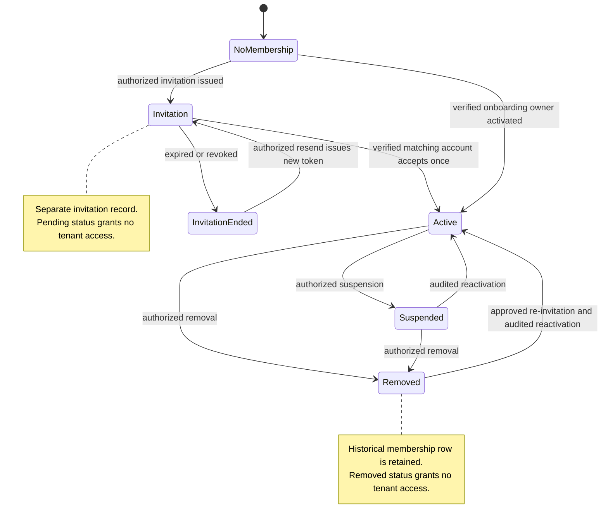
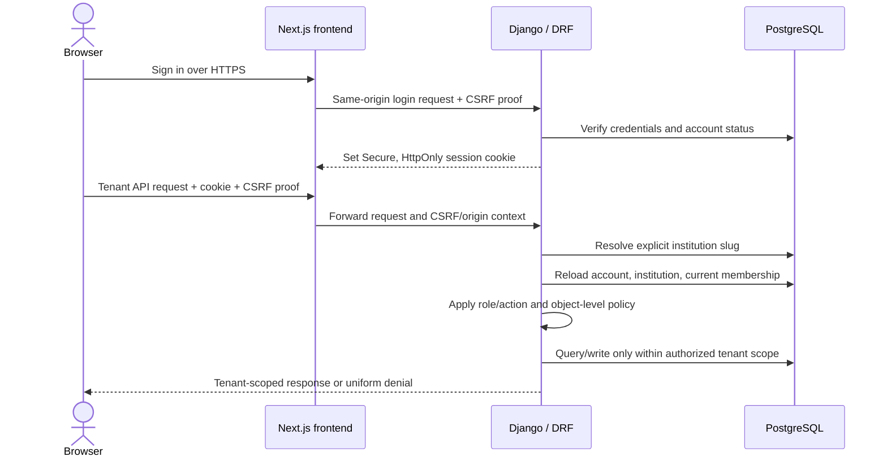

# Tenant and Authentication Decision Register

**Status:** Proposed; explicit project-owner approval is required before
implementation. No decision in this register is accepted.
**Scope:** Initial shared-schema Django/DRF backend with a Next.js frontend.
**Baseline:** The repository currently has a global UUID/email Django user,
PostgreSQL configuration, session authentication, protected health and OpenAPI
routes, Institution and Membership models, path-based tenant resolution, and a
reusable institution-role DRF permission. It has no invitation or tenant-owned
business API implementation. All decisions remain Proposed or Deferred; none
are Accepted.

This register makes the unresolved contracts reviewable. The proposed
multi-tenancy architecture, institution role/permission matrix, and isolation
test strategy are supporting documents, not evidence that policies have been
approved.
Approval should be recorded by the project owner against each decision ID; a
future implementation must follow only decisions marked **Accepted**.

Test references below point to cases in
[`TENANT_ISOLATION_TEST_STRATEGY.md`](../TENANT_ISOLATION_TEST_STRATEGY.md)
and existing focused API/model tests where noted. The strategy includes both
implemented baseline coverage and future planned cases; a reference alone does
not imply a behavior is implemented or a policy is approved. Where
authentication, institution provisioning, or retention behavior is not
covered, the gap is called out rather than assigning a nonexistent test ID.

## Status summary

| Status | Meaning |
|---|---|
| Proposed | Recommended default awaiting explicit project-owner approval |
| Accepted | Explicitly approved; none at this time |
| Rejected | Explicitly declined; none at this time |
| Deferred | Deliberately postponed until its stated trigger; not authorization to implement |

## Decision register

### ID-01 — Global identity — Proposed

**Problem.** Decide whether identity is shared across institutions or duplicated
per institution.

**Alternatives.**
- **One global account.** Advantage: one verified identity can join multiple
  institutions and avoids duplicate credentials. Disadvantage: account recovery
  and access disablement affect every membership.
- **Institution-specific accounts.** Advantage: identity and recovery can be
  isolated institution by institution. Disadvantage: duplicate accounts,
  fragmented identity, and difficult cross-institution user experience.

**Security implications.** Keep tenant authority off the global user. A global
account is not evidence of membership; normalize email consistently and enforce
uniqueness in the database. Disabling an account must block all memberships.
**Operational implications.** Account recovery and email changes require a
global identity workflow; membership and audit records refer to one stable user.
**Recommended default.** One global user account per person; membership and role
are separate institution-scoped records.
**Reasoning.** The current email-unique custom user model already provides this
identity baseline, and it supports the documented multi-institution use case
without treating identity as authority.
**Consequences.** Preserve the UUID user identity; create no tenant role field
on `User`. Email normalization and case-insensitive uniqueness semantics must
be verified before account workflows are implemented.
**Related tests.** `MA-09`, `MA-10`, `MA-11`.

### ID-02 — Multiple institution memberships — Proposed

**Problem.** Determine whether the global user can act in more than one tenant.

**Alternatives.**
- **Allow multiple memberships.** Advantage: supports staff, guardians, or
  students with legitimate relationships to multiple institutions. Disadvantage:
  every request must name and revalidate the institution.
- **Limit each account to one institution.** Advantage: simpler selection and
  fewer membership transitions. Disadvantage: duplicates identities and
  blocks cross-institution roles and family relationships.

**Security implications.** A user's memberships and roles are independent;
authority in one institution never implies authority in another.
**Operational implications.** Provide a membership list for navigation, but
never persist a mutable “current tenant” as authorization context.
**Recommended default.** Permit multiple active memberships with a distinct
role and status per institution.
**Reasoning.** This matches the shared global-identity model while keeping
authorization tenant-scoped.
**Consequences.** Enforce one membership per `(institution, user)` pair and
evaluate the selected membership on each request.
**Related tests.** `MA-06`, `MA-09`, `MA-10`, `TR-07`.

### MEM-01 — Membership lifecycle and history — Proposed

**Problem.** Define membership states, transitions, rejoining, and historical
record retention.

**Alternatives.**
- **Separate invitation from membership; retain membership rows.** Advantage:
  pending access is not confused with granted access and prior relationships
  remain referentially available. Disadvantage: requires explicit state
  transition and history handling.
- **Use one membership row for invited and active users, or delete on removal.**
  Advantage: fewer concepts or less visible retained data. Disadvantage:
  increases accidental access risk, loses history, and complicates reinstatement.

**Security implications.** Only `active` membership authorizes tenant requests.
Recommended states are `active`, `suspended`, and `removed`; invitation state
lives on the separate invitation. Rejoining reactivates the unique pair through
an explicit audited transition, not a duplicate row.
**Operational implications.** Preserve lifecycle timestamps and append audit
events for state and role changes. Define retention and privacy deletion
separately; retaining a row is not a decision to retain personal data forever.
**Recommended default.** Separate invitation and membership; keep one
institution/user membership record, retain it as history, and record each
transition in an audit trail.
**Reasoning.** This distinguishes invitation from access, prevents duplicate
membership authority, and keeps historical references stable.
**Consequences.** Establish allowed transitions and actor attribution before
writing models or migrations. A removed row is not active and grants no access.
**Related tests.** `MA-01`, `MA-02`, `MA-03`, `MA-05`, `MA-08`, `CR-05`.

The invitation is a separate record; it does not confer membership or tenant
access. Membership history remains even after removal.

### MEM-02 — Immediate membership revocation — Proposed

**Problem.** Determine whether existing login credentials continue to authorize
a user after membership suspension or removal.

**Alternatives.**
- **Recheck current membership for every protected request.** Advantage:
  revocation applies to the next authorization decision without waiting for a
  credential to expire. Disadvantage: requires a current policy/data lookup and
  careful caching.
- **Trust a role or tenant claim embedded in a long-lived credential.**
  Advantage: fewer lookups. Disadvantage: stale claims preserve access after
  revocation and require reliable revocation infrastructure.

**Security implications.** Suspension and removal deny the next request in that
institution. A still-authenticated global session may continue to access other
active memberships. Account disablement and password reset revoke all login
sessions.
**Operational implications.** Do not cache membership authority beyond the
request; if short-lived caches are later introduced, invalidate them on
membership changes and prove the bound.
**Recommended default.** Immediate authorization revocation: resolve current
institution and active membership on every protected request.
**Reasoning.** Authentication establishes the user; it must not freeze
tenant-specific authorization.
**Consequences.** Session/token lifetime cannot be used as the membership
revocation window. Background jobs must separately revalidate their
authorization contract when executed.
**Related tests.** `MA-02`, `MA-03`, `OP-02`, `CR-02`.

### INS-01 — Institution creation and activation — Proposed

**Problem.** Decide who may create an institution and when it becomes usable.

**Alternatives.**
- **Self-service onboarding with a verified creator as initial owner.**
  Advantage: low-friction setup. Disadvantage: abuse, duplicate institutions,
  and fraudulent claims need controls.
- **Platform-provisioned institutions only.** Advantage: controlled
  provisioning and identity verification. Disadvantage: operational bottleneck
  and support dependency.

**Security implications.** A new institution starts in `onboarding`; creation
does not grant access to existing institutions or bypass verification.
Activation requires a verified creator/owner and an explicit activation check.
**Operational implications.** Rate limits, duplicate/slug handling, abuse
response, and whether platform review is required must be set before launch.
**Recommended default.** Permit a verified creator to create an `onboarding`
institution and receive its initial owner membership; activate only after
required owner and institution checks pass. Keep platform provisioning as an
audited alternative if product governance requires approval.
**Reasoning.** This preserves a usable onboarding path while separating
creation from tenant access and activation.
**Consequences.** Exact verification, eligibility, and review requirements
remain project-owner decisions; do not expose business APIs to an onboarding
tenant beyond the explicitly approved setup flow.
**Related tests.** `TR-01`, `TR-05`, `MA-01`, `MA-08`. Add institution
creation/activation cases before implementing provisioning; the existing
strategy has no dedicated creation workflow case.

### INS-02 — Suspension, archival, and deletion — Proposed

**Problem.** Define institution lifecycle and access behavior when an
institution is suspended or closed.

**Alternatives.**
- **Onboarding → active → suspended → active, or closed.** Advantage:
  supports an auditable temporary hold and a distinct archived state.
  Disadvantage: requires explicit recovery and closure procedures.
- **Single active flag or immediate hard deletion.** Advantage: fewer states.
  Disadvantage: obscures business history, can break references, and makes
  accidental destructive action difficult to recover.

**Security implications.** `suspended` blocks ordinary tenant reads and writes;
reactivation is an authorized, audited transition. `closed` is an archive and
not available to ordinary users. Neither state can be bypassed by a valid
membership or stale credential.
**Operational implications.** Retention, export, backup, billing, legal hold,
and exceptional recovery procedures must be coordinated before closure.
**Recommended default.** Use `onboarding`, `active`, `suspended`, and `closed`;
do not hard-delete institution records through product APIs. Treat closure as
terminal for ordinary workflows; exceptional reopening requires a separately
authorized, audited operation.
**Reasoning.** An explicit lifecycle is safer to operate and preserves stable
references while avoiding an unreviewed purge policy.
**Consequences.** Define institution-wide suspension/closure effects on jobs,
exports, sessions, and data retention before production use.
**Related tests.** `TR-05`, `MA-02`, `MA-03`, `OP-02`, `OP-04`.

### INS-03 — Stable institution ID and slug changes — Proposed

**Problem.** Choose stable identity and URL behavior when an institution
renames.

**Alternatives.**
- **Immutable UUID primary key plus mutable slug locator.** Advantage: stable
  internal relations and human-readable paths. Disadvantage: slug alias
  lifecycle must be controlled.
- **Use slug as primary identity, or allow old slugs to be reassigned.**
  Advantage: simpler public addressing. Disadvantage: rename cascades or old
  links can resolve to a different tenant.

**Security implications.** A slug is untrusted routing input, never a secret or
proof of access. Resolve it to a stable institution, then check current
membership; reserve old slugs to prevent takeover.
**Operational implications.** Slug normalization, uniqueness, reserved words,
and rename authorization need defined validation.
**Recommended default.** Keep immutable UUID identity; allow an authorized
rename; retain the old slug as a reserved alias resolving to the same
institution. Do not rely on an HTTP redirect for API authorization or access.
**Reasoning.** Stable IDs avoid identity churn; reserved aliases prevent
stale links from being claimed by another institution without creating an
authorization bypass.
**Consequences.** Every alias follows the same lifecycle and membership checks.
Do not disclose institution existence to non-members; publish canonical links
only after authorized resolution.
**Related tests.** `TR-03`, `TR-04`, `TR-06`, `TR-07`, `DI-04`.

### INS-04 — Institution timezone and configuration — Proposed

**Problem.** Decide which settings are institution-specific and which are
application defaults.

**Alternatives.**
- **Persist a validated IANA timezone on the institution, default UTC.**
  Advantage: correct local date and schedule interpretation. Disadvantage:
  requires validation and consistent timezone-aware conversion.
- **Use one server timezone or a free-form settings blob.** Advantage: less
  initial schema work. Disadvantage: wrong local boundaries or unvalidated,
  unowned configuration.

**Security implications.** Configuration is not authorization. Validate
timezone values; never let a client-controlled timezone alter audit timestamps
or security expiry calculations.
**Operational implications.** Store timestamps in UTC; use the institution
timezone only for presentation and explicitly defined local scheduling.
Add locale, academic calendar, branding, and arbitrary JSON settings only when
their product owners define semantics.
**Recommended default.** A required IANA timezone with UTC default and a small,
typed set of institution settings.
**Reasoning.** This accommodates school schedules without turning settings
into an unbounded schema.
**Consequences.** Define timezone change effects on existing schedules before
that feature ships.
**Related tests.** `TR-01`, `CR-02`. Add timezone boundary tests with the
relevant scheduling feature; none of the existing 47 cases asserts timezone
semantics.

### AUTH-01 — Browser authentication architecture — Proposed

**Problem.** Select an authentication mechanism appropriate for a Next.js
browser frontend and Django REST Framework API.

**Alternatives.**
- **Django server-managed sessions and secure cookies.** Advantage: server
  controls lifetime and revocation; browser JavaScript need not hold a bearer
  credential. Disadvantage: cookie-authenticated writes require CSRF defense
  and session storage/expiry operations.
- **Short-lived access tokens with rotating refresh tokens.** Advantage:
  explicit API credentials and portability to non-browser clients.
  Disadvantage: browser token storage exposes XSS risk; refresh rotation,
  reuse detection, revocation, key rotation, and multi-device state add
  operational complexity.
- **External OIDC identity provider.** Advantage: delegates identity and
  potentially MFA. Disadvantage: introduces provider dependency, callback/state
  handling, account linking, and still needs an application session or token
  contract.

**Security implications.** Recommend sessions for browser requests, with
same-origin serving or a same-site reverse proxy for Next.js and Django.
Use a host-only `Secure`, `HttpOnly`, `SameSite=Lax` session cookie in
production; require Django CSRF validation and strict trusted-origin checks
for every unsafe cookie-authenticated request. Protect the Next.js boundary as
well if it acts as a BFF. Do not put bearer or refresh tokens in
`localStorage`/`sessionStorage`. HTTPS is mandatory.
**Operational implications.** Store sessions server-side, define idle and
absolute expiry, rotate the session on authentication/privilege changes, and
make logout/password-reset invalidation reliable. Production currently enables
secure session/CSRF cookies, but that is not an implemented login design.
**Recommended default.** Django server-managed sessions for the browser;
keep the browser and API same-origin through deployment routing. Reconsider
OIDC or a token protocol only for a demonstrated native/service-client need.
**Reasoning.** The current product is a browser application, not a public
third-party API. Sessions provide direct server revocation without accepting
the extra refresh-token lifecycle merely for popularity or perceived
statelessness.
**Consequences.** Add end-to-end CSRF, cookie, login/logout, session renewal,
and revocation tests before exposure. Multi-device logins may have independent
sessions; define whether per-device revocation is required before release.
**Related tests.** `MA-11`, `MA-02`, `MA-03`, `MA-10`, `CR-02`. The existing
strategy does not cover CSRF, cookie attributes, password reset, or session
fixation; add authentication-specific cases rather than treating these IDs as
coverage for them.

### AUTH-02 — Password reset, account recovery, and device sessions — Proposed

**Problem.** Establish a safe lifecycle for account recovery and active
sessions.

**Alternatives.**
- **Single-use expiring recovery link to a verified email with generic
  responses.** Advantage: familiar recovery path and bounded authority.
  Disadvantage: email account compromise remains a recovery risk.
- **Support-mediated recovery only, or reusable/non-expiring recovery
  credentials.** Advantage: human review or simpler link handling.
  Disadvantage: higher support burden or long-lived replay risk.

**Security implications.** Generate cryptographically random, single-use
recovery tokens; store only a digest; expire and consume atomically. Return
indistinguishable responses for known/unknown emails, rate-limit requests, and
never reveal account or institution membership. Reset revokes all sessions
and requires reauthentication. Do not weaken recovery to bypass future MFA.
**Operational implications.** Deliver mail through an owned provider,
monitor abuse and delivery failures, and document an account-compromise
response. Each device/browser login gets an independent server session;
logout ends the current session. Per-device listing/revocation is a separate
capability requiring a session registry.
**Recommended default.** Use verified-email reset with expiring one-time
tokens, generic responses, abuse controls, and revoke-all sessions on
password reset or account disablement. Permit multiple independent sessions;
defer per-device controls until required.
**Reasoning.** This bounds recovery authority while avoiding a custom
help-desk identity proofing system before its requirements exist.
**Consequences.** Define expiry/rate limits and support escalation before
implementation; write auth-flow tests for enumeration, replay, expiry, and
session invalidation.
**Related tests.** `MA-11`, `MA-02`, `MA-03`. No existing isolation case
covers password reset or account enumeration; add dedicated authentication
tests.

### TEN-01 — Tenant context in API paths — Proposed

**Problem.** Select one canonical way for a request to name its institution.

**Alternatives.**
- **Institution slug in the tenant-scoped API path.** Advantage: explicit,
  visible, bookmarkable, and straightforward to route and review. Disadvantage:
  slug changes need alias policy and paths expose a public locator.
- **Tenant header, query parameter, host, or session “current tenant”.
  Advantage: may shorten resource paths or support tenant-branded hosts.
  Disadvantage: hidden context, conflicting sources, proxy/cookie complexity,
  or stale state.

**Security implications.** Every locator is untrusted and must be resolved and
authorized. Reject conflicting tenant identifiers; never fall back to a
previous request or infer a tenant from a sole membership.
**Operational implications.** Keep non-tenant endpoints explicit and
endpoint-specific; do not put a tenant header in a second resolution path.
**Recommended default.** Use `/api/v1/institutions/{institution_slug}/...`
for tenant-scoped APIs.
**Reasoning.** It makes scope reviewable and does not rely on shared mutable
request context.
**Consequences.** Route definitions and API schema must consistently apply the
path contract; tenant switching is a client navigation choice, not a privilege
change.
**Related tests.** `TR-01`, `TR-02`, `TR-03`, `TR-06`, `TR-07`, `MA-10`,
`CR-02`.

### TEN-02 — Tenant validation and inaccessible responses — Proposed

**Problem.** Define resolution, membership revalidation, switching, and
responses for unknown or inaccessible tenants.

**Alternatives.**
- **Resolve institution and current membership on every protected request;
  conceal unknown/non-member/inactive tenant alike.** Advantage: immediate
  revocation and reduced enumeration. Disadvantage: requires consistent
  server-side checks.
- **Trust a selected tenant or token claim and distinguish unknown from
  forbidden tenants.** Advantage: fewer lookups and more diagnostic errors.
  Disadvantage: stale access and existence disclosure.

**Security implications.** Authenticate first (`401`); reject absent or
malformed context (`400`); return one unavailable response (proposed `404`)
for nonexistent, suspended/closed, or non-member institutions. Return `403`
for a known action denial only when revealing the object is safe; otherwise
conceal with `404`. Tenant switching starts a fresh lookup and membership
check. Do not share context in process globals, thread-locals, or cross-request
caches.
**Operational implications.** Keep error shapes uniform and scope logs; ensure
query, transaction, async, and exception paths cannot leak a prior request's
tenant.
**Recommended default.** Explicit path locator, canonical server-side
resolution, current membership/lifecycle check on every request, default
concealment, and no ambient tenant context.
**Reasoning.** This makes access revocation independent of credential expiry
and limits tenant enumeration.
**Consequences.** The exact status/body contract must be approved and then
tested; caches and background jobs need separate explicit context and freshness
rules.
**Related tests.** `TR-03`, `TR-04`, `TR-05`, `TR-07`, `MA-02`, `MA-03`,
`MA-06`, `MA-10`, `DI-04`, `CR-01`, `CR-02`.

### AUTHZ-01 — Institution-scoped role vocabulary — Proposed

**Problem.** Establish the institution-scoped role vocabulary without
confusing tenant roles with global Django permissions.

**Alternatives.**
- **Fixed institution-scoped roles on membership.** Advantage: simple,
  reviewable, and supports different authority for the same person in separate
  institutions. Disadvantage: role changes require code and policy review.
- **Global Django Groups or configurable per-tenant roles from the outset.**
  Advantage: familiar or flexible. Disadvantage: global groups cannot express
  distinct tenant roles; a configurable system expands administration and
  testing surface before needs are known.

**Security implications.** Store the tenant role on Membership, never on
`User`. Django `is_staff`/`is_superuser` do not grant institution authority.
Default-deny all actions not explicitly authorized.
**Operational implications.** Restrict role assignment to authorized
membership actions; audit transitions. Keep institution roles distinct from
platform operator access.
**Implementation fact.** `Membership.Role` currently defines exactly
`institution_admin`, `academic_staff`, `finance_staff`, `student`, and
`guardian`. There is no `owner`, `administrator`, `teacher`, or platform
operator membership role. These model choices are the implementation baseline,
not an approved policy decision.
**Recommended default.** Keep a small fixed vocabulary scoped to each
membership; do not treat Django Groups as tenant roles. Review whether the
existing vocabulary meets product needs before changing the model.
**Reasoning.** These are the current choices and support different roles for a
global identity at different institutions without making global groups tenant
authority.
**Consequences.** Do not add/change roles or infer grants from role names
without explicit approval. Platform support, owner succession, and any
additional role remain separate decisions.
**Related tests.** Model choices are verified by
`test_institution_membership_models.py`; tenant context and role authorization
are covered by `test_tenant_resolution_api.py` and
`test_institution_authorization_api.py`. These tests do not approve a
business-action matrix.

### AUTHZ-02 — Role checks versus object-level policy — Proposed

**Problem.** Prevent an institution role from becoming blanket access to all
objects and decide how policy can evolve.

**Alternatives.**
- **Role/action checks plus tenant-scoped querysets and object relationships.**
  Advantage: explicit and testable; enforces assignment, self, and guardian
  boundaries. Disadvantage: policy must be applied consistently at every
  service/API boundary.
- **Role alone grants broad access, or deploy a general-purpose policy engine
  immediately.** Advantage: broad grants are easy to implement; a policy engine
  can express complex rules. Disadvantage: broad grants invite IDOR; an engine
  adds policy language, operations, and review burden before use cases exist.

**Security implications.** Require both function-level role authorization and
object-level checks; scope lookups and related/nested references to the
validated institution. The tenant FK is an integrity boundary, not permission
to read. Default deny unknown actions.
**Operational implications.** Centralize small, typed policy functions and
reuse them from API views and services. Django model permissions may supplement
global permissions but cannot replace membership policy.
**Implementation baseline.** Tenant resolution is implemented separately.
`InstitutionRolePermission` requires the resolved request-local tenant context
and re-queries the active membership for that user and institution on each
request. A protected DRF view must directly declare a non-empty tuple or
frozenset named `allowed_membership_roles`; missing, empty, or unknown role
declarations fail closed. No production business endpoint currently uses this
permission.
**Recommended default.** Keep resolution and role authorization separate;
compose `IsAuthenticated`, `InstitutionTenantPermission`, and
`InstitutionRolePermission` on tenant-scoped views. Scope querysets and
relationships independently. Reassess custom fine-grained permissions only
when product requirements justify them.
**Reasoning.** This provides a reusable default-deny function boundary without
equating membership with unrestricted access or claiming object authorization.
**Consequences.** The permission only enforces declared function-level role
eligibility. It does not validate object ownership, assignment, student-self
access, guardian links, or any role/action grant. Test both permission behavior
and each eventual endpoint's object-level boundaries; never decide from
client-supplied role or tenant values.
**Related tests.** `MA-07`, `MA-08`, `DI-01`–`DI-08`, `RI-01`–`RI-07`,
`CR-04`.

### AUTHZ-03 — Institution role/action matrix — Proposed

**Problem.** Decide which existing institution roles may perform which
operations across institution, membership, admissions, student, academic,
enrolment, attendance, assessment, results, finance, reporting, communication,
and audit domains.

**Alternatives.**
- **Approve a documented operation-by-operation matrix before business APIs.**
  Advantage: reviewable, default-deny grants and explicit sensitive boundaries.
  Disadvantage: requires product decisions for workflows, relationships,
  publishing, exports, and separation of duties before endpoints are built.
- **Assign broad authority from role names or decide permissions ad hoc in
  endpoint code.** Advantage: faster first endpoint. Disadvantage: inconsistent
  grants, accidental privilege expansion, and weak reviewability.

**Security implications.** Every request still requires authentication,
resolved institution context, and current active membership. Roles are
institution-specific; another institution's role cannot authorize the
requested institution. Client-supplied role, tenant, membership, or object
identifiers never grant permission. Sensitive records and exports require
independent object, purpose, and field-level controls.
**Operational implications.** Keep the matrix versioned with architecture
decisions and map each production endpoint to explicit action rows and tests.
Mark unavailable workflows deferred and deny them until required policies and
controls exist.
**Recommended default.** Review
[`INSTITUTION_ROLE_PERMISSION_MATRIX.md`](../INSTITUTION_ROLE_PERMISSION_MATRIX.md)
as a proposed starting point using only current Membership role choices.
`ALLOW`, `DENY`, `CONDITIONAL`, and `DEFERRED` are policy vocabulary in that
proposal; `CONDITIONAL` and `DEFERRED` do not grant access before their
conditions and capabilities are implemented.
**Reasoning.** A separate matrix makes sensitive permissions and unsupported
assumptions visible without implementing or approving grants through code or
documentation alone.
**Consequences.** The matrix is not accepted. The project owner must review
each conditional area, guardian/self relationships, owner/final-owner
safeguards, publication, finance segregation, audit access, exports, and
platform support before any production endpoint relies on it. No role
hierarchy or new role is implied.
**Related tests.** Future endpoint tests should map to reviewed matrix actions
and include positive controls, denied roles, cross-institution attempts,
membership/role changes, and object-scope checks. Existing permission tests
verify the generic boundary only.

### INV-01 — Invitation issue and acceptance — Proposed

**Problem.** Define how a prospective member is invited and becomes active.

**Alternatives.**
- **Separate institution-scoped invitation with verified-email acceptance.**
  Advantage: an invitation can precede account creation and assigned role is
  explicit. Disadvantage: requires secure token lifecycle and atomic consume.
- **Create a membership from an email address before acceptance, or allow
  self-join by institution locator.** Advantage: fewer steps. Disadvantage:
  grants authority without proof of control or institutional authorization.

**Security implications.** Only an authorized owner/administrator may invite
within a permitted role ceiling. Generate a cryptographically random,
single-use token, store only its digest, and bind it to institution, recipient,
role, issuer, expiry, and status. Acceptance requires authentication and a
verified account email matching the invitation; it consumes the token and
creates/reactivates membership atomically. The invitee cannot choose a stronger
role. Owner role requires a separate controlled owner-transfer path.
**Operational implications.** Email delivery is asynchronous/externally
dependent; token expiry and failed delivery must not create membership.
**Recommended default.** A separate invitation with proposed seven-day
expiry, verified-email acceptance, atomic one-time consumption, and a
membership created only on acceptance.
**Reasoning.** A pending invitation is a bounded offer, not an authorization
credential.
**Consequences.** Seven days is a proposed policy value requiring owner
approval; implement token hashing, expiry, and state transitions with
PostgreSQL transactional tests.
**Related tests.** `MA-04`, `MA-05`, `MA-08`, `CR-03`, `CR-04`.

### INV-02 — Duplicate, resend, revoke, and enumeration — Proposed

**Problem.** Prevent invitation confusion, replay, and account discovery.

**Alternatives.**
- **One pending invitation per institution and normalized email; resend
  invalidates the prior token.** Advantage: unambiguous active offer and bounded
  token set. Disadvantage: resend must be atomic and visible to authorized
  administrators.
- **Allow multiple pending invites or leave old tokens valid on resend.**
  Advantage: simpler delivery retries. Disadvantage: role ambiguity, replay,
  and unexpected acceptance.

**Security implications.** Normalize recipient identity consistently; enforce
one pending invite per institution/email at the database boundary. Revoke,
accept, expire, and resend are mutually exclusive single-use transitions.
Responses to public invitation/recovery requests must not disclose whether an
account or membership exists; rate-limit requests and keep token data out of
logs.
**Operational implications.** Authorized administrators need to inspect
pending status, expiry, and revoke/resend actions without seeing raw tokens.
Mail delivery retries must not issue additional valid tokens.
**Recommended default.** One pending invite per institution/email; resend
revokes and rotates the token; explicit revocation; generic external responses.
**Reasoning.** A single current offer reduces both ambiguous state and replay
paths.
**Consequences.** Database uniqueness must account for pending status and
concurrency. Add dedicated enumeration and resend race tests; the existing
matrix covers expiry and pending access, not enumeration.
**Related tests.** `MA-04`, `MA-05`, `MA-08`, `DI-04`, `CR-03`, `CR-04`.

### OWN-01 — Minimum active owners — Proposed

**Problem.** Avoid an institution losing its final owner through removal,
suspension, demotion, or account disablement.

**Alternatives.**
- **Require at least one active owner at all times.** Advantage: preserves
  accountable institution administration. Disadvantage: adds recovery
  procedures for owner loss and termination.
- **Allow zero owners and rely on platform support.** Advantage: simpler
  membership changes. Disadvantage: orphaned institution and routine dependence
  on privileged support.

**Security implications.** Do not permit a user to remove/demote/suspend the
last active owner or disable that account while leaving no owner. The rule does
not grant an owner platform privileges.
**Operational implications.** A separately authorized recovery process is
required if the only owner is unreachable or compromised; that process must be
audited.
**Recommended default.** Require at least one active owner for every active
institution; activation requires the initial owner.
**Reasoning.** Ownership is the minimum administrative safety invariant, not
an implied role privilege over all tenant data.
**Consequences.** Define what happens when an owner account is globally
disabled and who may recover the institution before enabling account
deactivation.
**Related tests.** `MA-08`, `CR-05`.

### OWN-02 — Concurrent ownership changes and audit — Proposed

**Problem.** Ensure simultaneous role changes cannot jointly violate the
minimum-owner rule and provide trustworthy records of sensitive actions.

**Alternatives.**
- **Serialize owner-affecting transitions in a database transaction with a
  stable institution lock.** Advantage: closes the read/modify race and is
  testable on PostgreSQL. Disadvantage: adds contention and requires careful
  lock ordering.
- **Check owner count without locking, or rely only on an application
  pre-check.** Advantage: simpler. Disadvantage: concurrent requests can both
  pass and leave zero owners.

**Security implications.** In one transaction, lock the institution (or another
stable coordination row), reload current active owners, validate the change,
persist it, and write an immutable audit event. Derive actor, institution,
target, time, action, and outcome on the server. Never log credentials or
sensitive student payloads.
**Operational implications.** Exercise lock behavior and rollback on
PostgreSQL; define audit retention, access, integrity, and alerting before
production use.
**Recommended default.** Transactional serialization for owner-affecting
changes, with append-only audit events and explicit failure/rollback semantics.
**Reasoning.** A normal count check or row-level membership lock alone may not
serialize competing changes to different memberships; a shared institution
lock makes the invariant explicit.
**Consequences.** Define consistent lock ordering for future bulk operations.
The audit store and retention policy remain separate implementation decisions.
**Related tests.** `CR-03`, `CR-05`, `OP-08`.

### PLAT-01 — Platform operator and support access — Proposed

**Problem.** Establish whether platform operators can access institution data
and constrain support workflows.

**Alternatives.**
- **No routine cross-tenant access; explicit just-in-time scoped grant for
  approved support.** Advantage: least privilege and attributable exceptional
  access. Disadvantage: adds approval, expiry, and support workflow work.
- **Standing unrestricted superuser access.** Advantage: operationally
  convenient. Disadvantage: high-impact credential compromise and weak
  tenant-boundary accountability.

**Security implications.** A platform operator role is distinct from
`is_staff`, `is_superuser`, and institution membership. Default access is
platform metadata only, not student or financial data. Any support access
requires a purpose, target institution, requested scope, actor, approver where
feasible, short expiry, explicit grant, and auditable reads/writes. Prevent
routine global query paths and log every use; redact credentials and minimize
student data.
**Operational implications.** Establish break-glass staffing, approval
coverage, audit review, and emergency response. Emergency access is still
time-bounded and reviewed afterward.
**Recommended default.** Deny ordinary cross-tenant data access; use
just-in-time, institution-scoped, purpose-bound support access with strong
operator authentication and immutable audit.
**Reasoning.** Support need does not justify standing unrestricted authority.
**Consequences.** The operator workflow and audit storage must exist before
production support access. Superuser accounts remain tightly limited to
bootstrap/operations and are not an application authorization shortcut.
**Related tests.** `MA-08`, `OP-04`, `OP-08`.

## Deferred decisions

These are explicit **Deferred** items, not permission to implement an
unreviewed substitute. Each requires a new owner-approved decision if its
trigger is reached.

### DFR-01 — MFA method and enforcement — Deferred

**Problem.** Select factors and decide which accounts/actions require MFA.
**Alternatives.** Application-managed TOTP/WebAuthn has the advantage of
control over enrollment and enforcement, and the disadvantage of added
recovery and support burden. Federated MFA has the advantage of delegating
factor verification, and the disadvantage of provider dependency and
identity-linking complexity.
**Security implications.** Require step-up protection for operator and
owner-sensitive actions before those workflows are exposed.
**Operational implications.** Requires enrollment, recovery-code handling,
device-loss support, and accessible recovery.
**Recommended default.** Defer selection; require a risk review before
production operator/support access and before broad account rollout.
**Reasoning.** The user groups, threat level, and recovery capability need
owner/product input.
**Consequences.** Do not imply MFA exists; keep the auth design extensible and
never make email recovery silently bypass a future factor.
**Related tests.** `MA-11`, `MA-08`, `OP-04`. Dedicated MFA enrollment,
challenge, recovery, and step-up tests will be required.

### DFR-02 — Custom permissions and tenant-configurable roles — Deferred

**Problem.** Decide whether institutions may define roles or fine-grained
permissions.
**Alternatives.** Fixed code-owned role/action policy has the advantage of
predictability and reviewability, and the disadvantage of limited flexibility.
Configurable roles have the advantage of local delegation, and the disadvantage
of a policy editor, conflict resolution, migrations, and a larger attack
surface.
**Security implications.** Never add client-controlled role names or
permissions as a shortcut; preserve default-deny object policy.
**Operational implications.** Trigger a design review only after documented
customers require stable, distinct permissions that fixed roles cannot
represent.
**Recommended default.** Defer; use fixed roles and centralized checks first.
**Reasoning.** A policy engine is not justified by hypothetical flexibility.
**Consequences.** If triggered, define permission precedence, delegation,
versioning, audit, and migration behavior before implementation.
**Related tests.** `MA-07`, `MA-08`, `DI-01`–`DI-08`, `RI-01`–`RI-07`.

### DFR-03 — PostgreSQL Row-Level Security or stronger isolation — Deferred

**Problem.** Decide whether shared-schema application enforcement needs
database-level tenant policies or physical separation.
**Alternatives.** Shared-schema application enforcement has the advantage of
operational simplicity, and the disadvantage that a missed filter can expose
data. PostgreSQL RLS has the advantage of defense in depth, and the
disadvantage of transaction-local context requirements. Schema/database per
tenant has the advantage of stronger separation, and the disadvantage of
greater provisioning, migration, backup, and support complexity.
**Security implications.** Database policy cannot identify the end user by
itself and must not replace application authorization.
**Operational implications.** Evaluate only with evidence from risk,
compliance, scale, or a customer contract; prove pooling, admin, worker,
migration, test, and rollback behavior.
**Recommended default.** Defer; retain explicit tenant FKs, scoped querysets,
constraints, and PostgreSQL regression tests.
**Reasoning.** No tenant models or context propagation exist to secure today.
**Consequences.** A later evaluation must include failure-mode and operational
testing before enabling policies.
**Related tests.** `DI-05`, `RI-01`–`RI-07`, `CR-01`, `CR-02`, `CR-04`.

### DFR-04 — Retention periods and hard deletion — Deferred

**Problem.** Set retention and deletion timelines for institutions,
memberships, invitations, audit records, and personal data.
**Alternatives.** Indefinite retention has the advantage of preserving audit
references, and the disadvantage of increased privacy exposure. Fixed
retention and hard deletion have the advantage of reducing retained data, and
the disadvantage of potential conflict with legal, financial, or institutional
obligations.
**Security implications.** Do not interpret “retain membership history” or
“archive institution” as permission for indefinite personal-data retention.
Apply least-privilege access and delete invitation token digests after use or
expiry according to the final policy.
**Operational implications.** Requires jurisdiction, contractual, backup,
audit, and restore input; deleting production records may not immediately
remove backup copies.
**Recommended default.** Defer exact periods and irreversible deletion until
product/legal owners define obligations; preserve soft-archive/history
references meanwhile and collect no unnecessary data.
**Reasoning.** Retention cannot be safely chosen from the current repository
baseline alone.
**Consequences.** Do not launch retention promises or permanent deletion APIs
before an approved schedule and backup-expiry procedure.
**Related tests.** `OP-08`, `TR-05`. Add deletion, export, backup, and
audit-retention cases when their policies are approved.

## Security invariants

These are proposed cross-cutting constraints; owner approval is required before
they become implementation acceptance criteria.

1. A user ID, institution slug/UUID, role name, or object ID supplied by a
   client never proves authorization.
2. Authenticate first; resolve one explicit institution; check its current
   lifecycle and the user's current active membership on every protected
   request.
3. Use default-deny function authorization and independently enforce
   object-level, assignment, self, and verified guardian relationship rules.
4. Scope every tenant-owned query and every nested/related write to the same
   validated institution. Database constraints complement, not replace,
   authorization.
5. No invitation, token claim, prior request, or frontend tenant selection
   grants active membership. Membership suspension/removal denies the next
   protected request.
6. Do not hold tenant context in mutable process-global or unsafe
   thread-local state. Pass it explicitly through services and jobs and reload
   current status where the job's contract requires authorization.
7. Browser credentials are not readable bearer tokens; cookie-authenticated
   writes require CSRF defenses, and secrets/tokens never enter logs.
8. Preserve at least one active owner for each active institution, with
   transaction-safe serialization and auditable sensitive changes.
9. Platform support access is not standing cross-tenant authority; grants are
   scoped, time-bounded, purpose-bound, and audited.
10. Every security-sensitive path has positive and negative regression tests;
    PostgreSQL is required for locking, constraint, and concurrency claims.

## Authentication and tenant request flow

The following is the proposed browser/API flow. It is not implemented.

**Transport contract:** serve the browser-facing frontend and API on one
origin, or use an equivalent same-site reverse proxy. Validate the exact
deployment topology before enabling cookies. For unsafe methods, validate
Django CSRF tokens and trusted origins; a Next.js BFF must apply its own
CSRF/origin protections before forwarding. Do not use wildcard trusted origins
or expose the session cookie to browser JavaScript. Unauthenticated requests
must not resolve or disclose tenant data.

## Approval, dependencies, and implementation consequences

Before implementation, the project owner should approve or amend each
Proposed decision ID, explicitly accept the role/action matrix, and decide the
open questions below. A merged architecture or test-plan PR is not approval.

Implementation dependencies after approval:

1. Decide and document the browser deployment topology, session expiry,
   password/email verification, account recovery, and auth-specific test
   cases before login or invitation acceptance.
2. Implement institution, membership, invitation, and audit schemas only after
   identity, lifecycle, owner, invitation, and retention contracts are
   approved.
3. Implement tenant resolution and authorization only after the role/action
   matrix and response concealment contract are approved; run tenant and
   concurrency tests against PostgreSQL CI.
4. Do not ship tenant-scoped domain APIs, admin paths, exports, or background
   jobs until their authorization and isolation cases are enforceable in CI.
5. Treat every choice marked Deferred as out of initial scope until a new
   reviewed decision changes its status.

### Questions requiring project-owner input

- Is self-service institution creation permitted, and what verification or
  platform review is required before activation?
- Are the proposed seven-day invitation expiry and one pending invitation per
  institution/email acceptable?
- What session idle/absolute expiry, account-verification, and
  password-recovery requirements should apply?
- Are the five implemented membership role names sufficient, which proposed
  actions should `institution_admin` be allowed to perform on sensitive
  learner records, and is a distinct owner role and succession workflow
  required?
- What is the approved closure, data-retention, audit-retention, and legal
  deletion policy?
- Is per-device session revocation required for the initial release?
- What approval and emergency process is required for just-in-time platform
  support access?
- Which deployment topology will provide same-origin cookie and CSRF behavior?
